# Wazuh Manual: installation, custom rules, dashboards and alerting

[🇧🇷 Português](README.md) | 🇺🇸 English

> **Unofficial material.** This repository is not official Wazuh documentation and is not endorsed by Wazuh Inc. Credit for the platform belongs to the Wazuh team and its community. Always refer to https://documentation.wazuh.com.

## Repository layout

| Folder | Content |
|---|---|
| `rules/` | 26 custom rule files (9NN prefix + `local_rules.xml`) |
| `lists/` | Example CDB lists |
| `dashboards/` | 18 NDJSON dashboards (single `00-` file or one per dashboard) |
| `alerting/` | E-mail channel and backup monitor for Alerting |
| `agent/` | Example `agent.conf` (Windows audit policy) |
| `scripts/` | `.bat` to enable remote commands on Windows agents |
| `docs/images/` | Screenshots used in the manual |

### Quick start

```bash
cp rules/*.xml /var/ossec/etc/rules/
cp lists/lolbins_vigiados /var/ossec/etc/lists/
chown wazuh:wazuh /var/ossec/etc/rules/*.xml /var/ossec/etc/lists/*
chmod 660 /var/ossec/etc/rules/*.xml
/var/ossec/bin/wazuh-analysisd -t   # validate before restarting
systemctl restart wazuh-manager
```

Before using the rules, adapt the **internal networks**, **CDB lists** and **decoder names** to your environment and register the lists in `ossec.conf` (section 6.4). Rules for sources such as Cisco ASA, OpenVPN, Kaspersky, Forcepoint and Squid depend on custom decoders; without them, those rules simply do not fire.

## Contents

- [1. About Wazuh](#1-about-wazuh)
  - [1.1. Platform components](#11-platform-components)
- [2. Installing Wazuh](#2-installing-wazuh)
  - [2.1. Hardware requirements (single node)](#21-hardware-requirements-single-node)
  - [2.2. Ports](#22-ports)
  - [2.3. Quickstart (single node)](#23-quickstart-single-node)
  - [2.4. Recommended post-installation steps](#24-recommended-post-installation-steps)
  - [2.5. Upgrading](#25-upgrading)
- [3. Accessing the web interface](#3-accessing-the-web-interface)
- [4. Navigating the interface](#4-navigating-the-interface)
  - [4.1. Agent Summary](#41-agent-summary)
  - [4.2. Last 24 Hours Alerts](#42-last-24-hours-alerts)
  - [4.3. Endpoint Security](#43-endpoint-security)
  - [4.4. Threat Intelligence](#44-threat-intelligence)
  - [4.5. Security Operations](#45-security-operations)
  - [4.6. Cloud Security](#46-cloud-security)
- [5. Daily monitoring](#5-daily-monitoring)
  - [5.1. Threat Hunting](#51-threat-hunting)
  - [5.2. Configuration Assessment](#52-configuration-assessment)
  - [5.3. Custom dashboards](#53-custom-dashboards)
- [6. Command-line administration](#6-command-line-administration)
  - [6.1. Custom rule structure](#61-custom-rule-structure)
  - [6.2. Testing rules](#62-testing-rules)
  - [6.3. Decoders](#63-decoders)
  - [6.4. CDB lists](#64-cdb-lists)
  - [6.5. ossec.conf](#65-ossecconf)
  - [6.6. Collecting journald](#66-collecting-journald)
- [7. Sensitive directories and files](#7-sensitive-directories-and-files)
- [8. Installing agents](#8-installing-agents)
  - [8.1. From the Dashboard (recommended)](#81-from-the-dashboard-recommended)
  - [8.2. From the website installer](#82-from-the-website-installer)
  - [8.3. Manual enrollment on the server](#83-manual-enrollment-on-the-server)
- [9. Remote commands and group configuration](#9-remote-commands-and-group-configuration)
  - [9.1. Enabling on the agent](#91-enabling-on-the-agent)
  - [9.2. Configuring on the server](#92-configuring-on-the-server)
- [10. Agent groups](#10-agent-groups)
- [11. Custom dashboards](#11-custom-dashboards)
- [12. Alerting and notifications](#12-alerting-and-notifications)
- [13. Anomaly detection](#13-anomaly-detection)
- [14. Troubleshooting](#14-troubleshooting)
- [15. Credits and references](#15-credits-and-references)

> **Note:** **Unofficial material.** This manual is an independent work based on running Wazuh in production. It is **not** official Wazuh documentation, it is not reviewed or endorsed by Wazuh Inc., and it may become outdated with new releases. Always check the official documentation at https://documentation.wazuh.com before applying any procedure in production.

**Credits:** Wazuh is an open source project maintained by **Wazuh Inc.** and its community. All credit for the platform, the built-in rules and decoders, and the official documentation belongs to them. Wazuh names and logos are trademarks of their respective owners. This material only describes one way of using and extending the platform.

**Reference environment:** Wazuh 4.14 (single-node installation, Red Hat family), Windows and Linux agents, and log sources such as Active Directory, SQL Server, VPN (Cisco ASA and OpenVPN), Squid proxy, pfSense, Suricata, antivirus and DLP. All addresses, names and domains in this manual are **examples**. Rule descriptions and dashboard titles in the repository files are in Portuguese.

## 1. About Wazuh

Wazuh is an open source security platform for monitoring, threat detection, incident response and security event management. It combines **SIEM** and **XDR** capabilities, collecting, processing and correlating data from operating systems, applications and network devices into a single view. It supports **Windows, Linux and macOS**, network devices, cloud services and business applications.

### 1.1. Platform components

| Component | Role |
|---|---|
| **Wazuh Agent** | Installed on monitored assets. Collects logs, events, inventory and integrity data and sends them to the server. |
| **Wazuh Server (Manager)** | Receives events, applies **decoders** and **rules**, generates alerts and manages agents. Custom rules live here. |
| **Wazuh Indexer** | OpenSearch-based database that stores and indexes alerts. |
| **Wazuh Dashboard** | Web interface for analysis, dashboards, Alerting, Anomaly Detection and administration. |

An event always follows the same path: the **agent** collects it, the **decoder** parses it and extracts fields, the **rule** decides whether it becomes an alert and at which level, the **indexer** stores it and the **dashboard** displays it. Understanding this path is the key to almost every problem in the troubleshooting section.

---

## 2. Installing Wazuh

The simplest option is the **quickstart**, which installs the indexer, server and dashboard on a single machine using the official assistant. Larger environments should use the **distributed installation** described in the official guide.

> **Warning:** Commands, versions and requirements change between Wazuh releases. Check the official guide before installing: https://documentation.wazuh.com/current/installation-guide/

### 2.1. Hardware requirements (single node)

The official guidance sizes the server by number of agents, for about 90 days of stored alerts:

| Agents | vCPU | RAM | Disk |
|---|---|---|---|
| Up to 25 | 4 | 8 GB | 50 GB |
| 25 to 50 | 8 | 8 GB | 100 GB |
| 50 to 100 | 8 | 8 GB | 200 GB |
| Over 100 | Distributed installation |  |  |

Supported systems: 64-bit Linux distributions such as Red Hat/Rocky/Alma, Amazon Linux, Ubuntu and Debian, on vendor-supported versions.

### 2.2. Ports

| Port | Protocol | Usage |
|---|---|---|
| 443 | TCP | Wazuh Dashboard (web) |
| 1514 | TCP | Agent communication |
| 1515 | TCP | Agent enrollment |
| 514 | TCP/UDP | Syslog (firewalls, appliances), if enabled |
| 55000 | TCP | Wazuh server API |
| 9200 | TCP | Wazuh Indexer (OpenSearch API) |

```
firewall-cmd --permanent --add-port={443,1514,1515,55000}/tcp
firewall-cmd --permanent --add-port=514/udp
firewall-cmd --reload
```

### 2.3. Quickstart (single node)

Run as **root** on the target server. The URL contains the release line (4.x):

```
curl -sO https://packages.wazuh.com/4.x/wazuh-install.sh
sudo bash ./wazuh-install.sh -a
```

At the end, the assistant shows the dashboard address, the **admin** user and its generated password, and creates **wazuh-install-files.tar** with all passwords and certificates.

> **Important:** Store **wazuh-install-files.tar** in a safe place (password vault or protected backup). It contains every credential of the environment.

```
tar -O -xvf wazuh-install-files.tar wazuh-install-files/wazuh-passwords.txt
```

In a default installation, the dashboard **admin** user is the same **admin** user of the indexer (port 9200). Indexer passwords are stored as hashes: if lost, they cannot be read, only reset with the official password tool, which updates every component together.

### 2.4. Recommended post-installation steps

1. **Change default passwords** with the official tool (`wazuh-passwords-tool.sh`).
2. **Set the server time zone** (`timedatectl set-timezone <zone>`). Rules with `<time>` use the server clock.
3. **Configure e-mail** in the `<global>` block of `/var/ossec/etc/ossec.conf`. Native e-mail does not support SMTP authentication; use a relay that accepts mail from the server IP.
4. **Collect the server own logs.** On recent minimal distributions (such as RHEL 9), SSH, sudo and PAM logs may go only to **journald**. Add journald collection (section 6.6).
5. **Create the custom rule structure** described in section 6 (file prefixes, ID ranges and headers).
6. **Back up** `/var/ossec/etc/` before any change and periodically.

### 2.5. Upgrading

Before upgrading: back up `/var/ossec/etc/`, read the release notes and follow the documented order (indexer, server, dashboard and agents last). Custom files in `/var/ossec/etc/` are preserved; built-in files in `/var/ossec/ruleset/` are replaced.

---

## 3. Accessing the web interface

Open a browser, enter the **IP address or hostname of the Wazuh Dashboard** and log in. Example: https://192.0.2.10

<p align="center">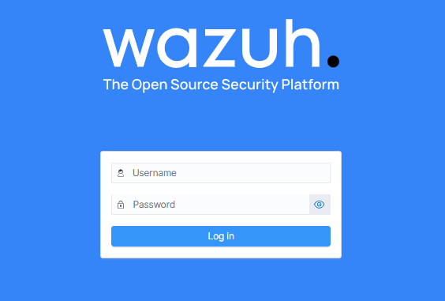<br><em>Figure 1 - Login screen</em></p>

Each analyst should have an **individual account** with the appropriate role, and credential sharing should be forbidden by internal policy.

<p align="center">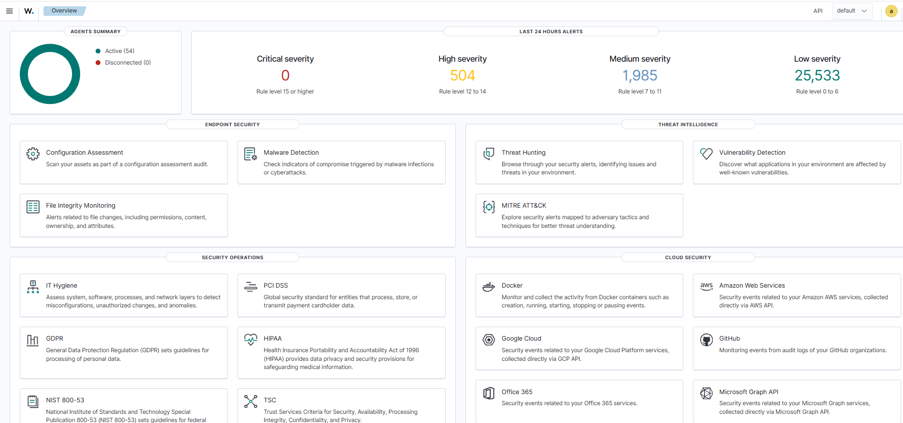<br><em>Figure 2 - Wazuh home screen</em></p>

## 4. Navigating the interface

### 4.1. Agent Summary

Shows how many agents are **active** and **disconnected**, so assets that stopped reporting are quickly identified.

<p align="center">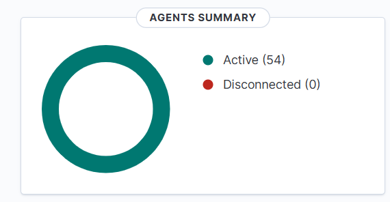<br><em>Figure 3 - Agent summary</em></p>

### 4.2. Last 24 Hours Alerts

- **Low, levels 0 to 6:** informational or low-impact events.
- **Medium, levels 7 to 11:** unusual behavior that needs analysis.
- **High, levels 12 to 14:** potentially malicious activity. From level 12, Wazuh sends e-mail automatically (`email_alert_level`).
- **Critical, level 15:** high risk, immediate handling.

<p align="center">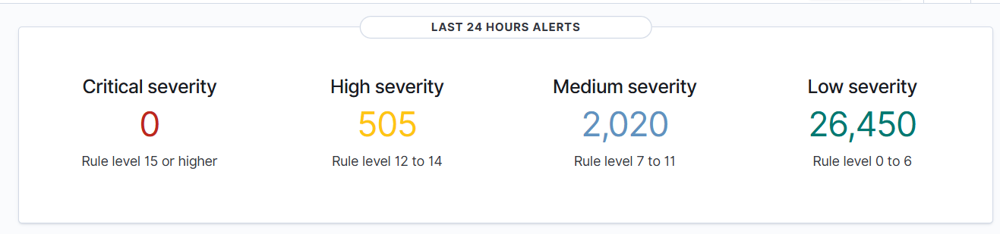<br><em>Figure 4 - Alert severity</em></p>

> **Note:** Alerts below level 3 are **not stored** in the index (`log_alert_level`). Level 0 to 2 rules are used to silence noise and never appear in dashboards.

### 4.3. Endpoint Security

<p align="center">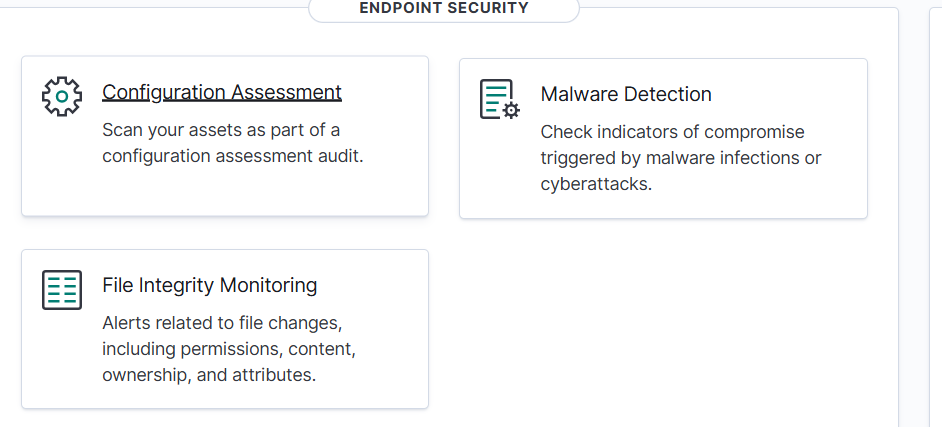<br><em>Figure 5 - Endpoint Security menu</em></p>

- **Configuration Assessment:** checks assets against benchmarks such as the **CIS Benchmarks**.
- **Malware Detection:** indicators of compromise and signs of malicious activity.
- **File Integrity Monitoring (FIM):** changes to content, permissions, attributes and ownership of monitored files.

### 4.4. Threat Intelligence

<p align="center">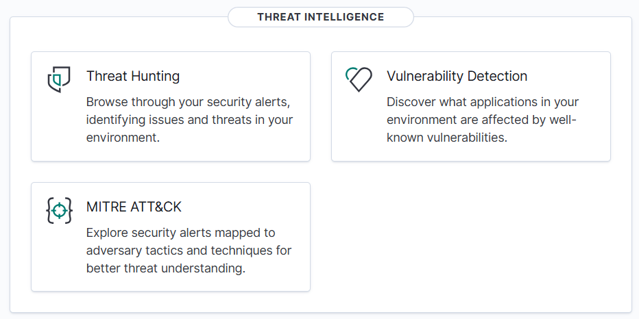<br><em>Figure 6 - Threat Intelligence menu</em></p>

- **Threat Hunting:** search and filter alerts by level, agent, group, rule and time.
- **Vulnerability Detection:** known CVEs in the software inventory. A vulnerability does not mean the asset is compromised.
- **MITRE ATT&CK:** maps alerts to tactics and techniques. The mapping supports analysis but does not confirm a technique was used.

### 4.5. Security Operations

Security posture and compliance: **IT Hygiene**, **PCI DSS**, **GDPR**, **HIPAA**, **NIST SP 800-53** and **TSC**. Results support audits but do **not** replace formal assessments.

<p align="center">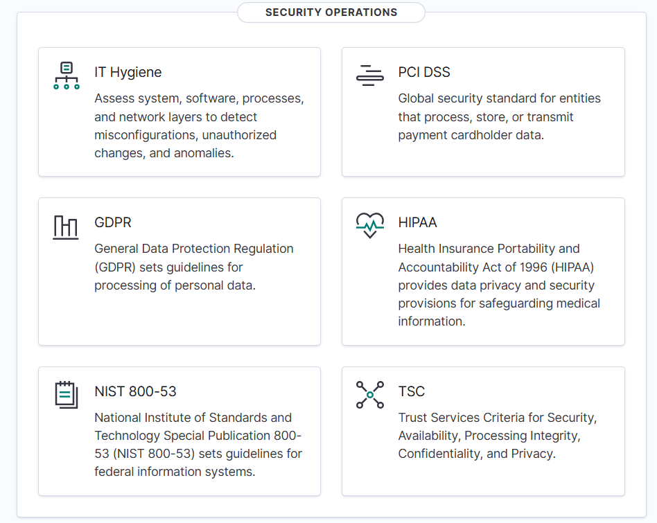<br><em>Figure 7 - Security Operations menu</em></p>

### 4.6. Cloud Security

Events from **Docker, AWS, Google Cloud, GitHub, Office 365** and **Microsoft Graph API**, depending on the configured integrations and permissions.

<p align="center">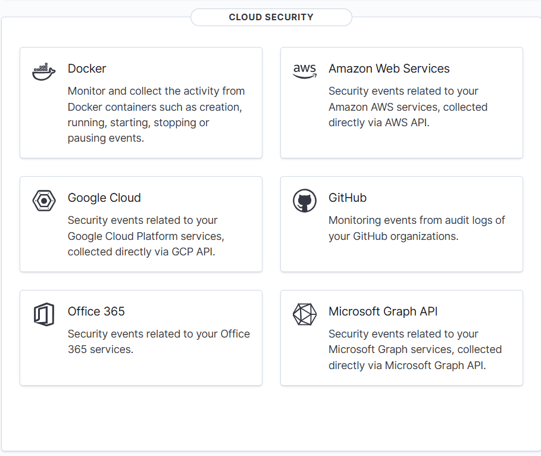<br><em>Figure 8 - Cloud Security menu</em></p>

---

## 5. Daily monitoring

### 5.1. Threat Hunting

<p align="center">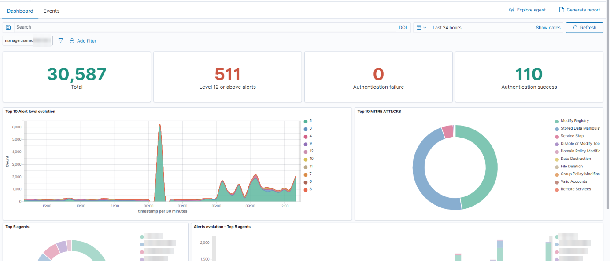<br><em>Figure 9 - Threat Hunting dashboard</em></p>

Shows the events of the selected period (default: last 24 hours). The **Events** tab lists them according to the period and filters.

<p align="center">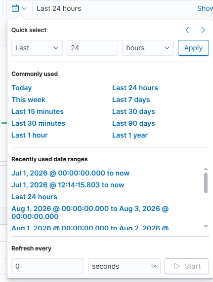<br><em>Figure 10 - Time range settings</em></p>

> **Warning:** Set **Refresh Every** to at least **1 minute**. Shorter intervals increase indexer queries and may affect performance.

<p align="center">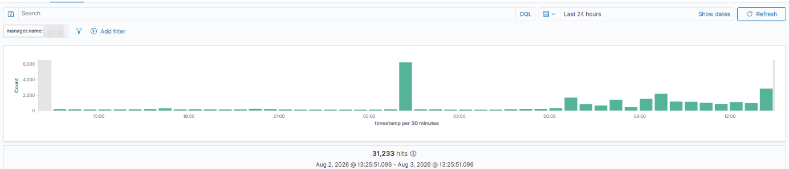<br><em>Figure 11 - Event histogram</em></p>

Main columns: **timestamp**, **agent.name**, **rule.description**, **rule.level** and **rule.id**.

<p align="center">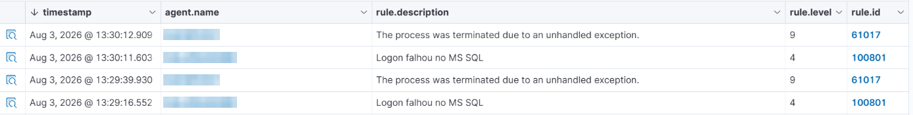<br><em>Figure 12 - Alerts table</em></p>

Click the **expand icon** in the first column to open the details panel. This is where you find the **exact field names** (for example `data.win.eventdata.targetUserName`), essential for rules, filters and dashboards.

<p align="center"><br><em>Figure 13 - Opening alert details</em></p>

<p align="center">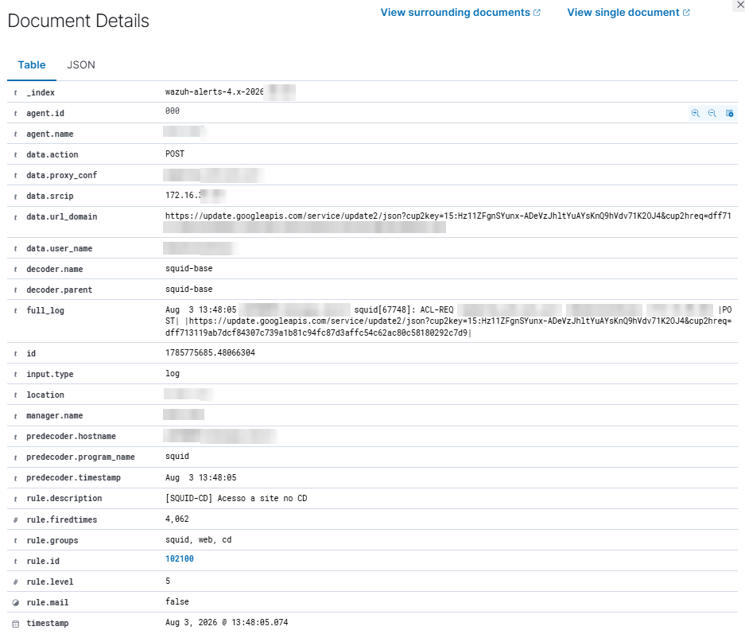<br><em>Figure 14 - Alert details (table)</em></p>

<p align="center">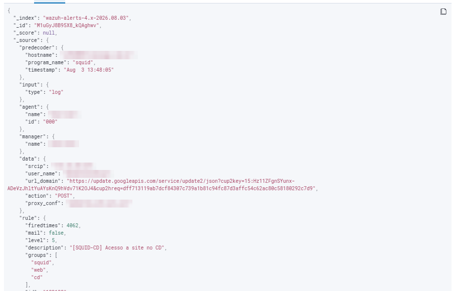<br><em>Figure 15 - Alert details (JSON)</em></p>

**View single document** opens the alert in a new window; **View surrounding documents** opens Discover with nearby events for context.

<p align="center"><br><em>Figure 16 - Opening details in other windows</em></p>

### 5.2. Configuration Assessment

> **Warning:** CIS recommendations are good practices and must **not** be applied blindly. A deviation is not necessarily a vulnerability.

<p align="center">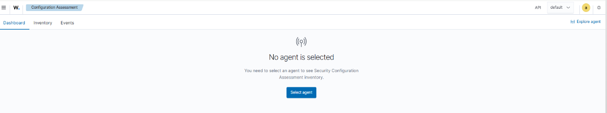<br><em>Figure 17 - Selecting an agent</em></p>

The assessment is per agent: use **Explore agent** or **Select agent**.

<p align="center">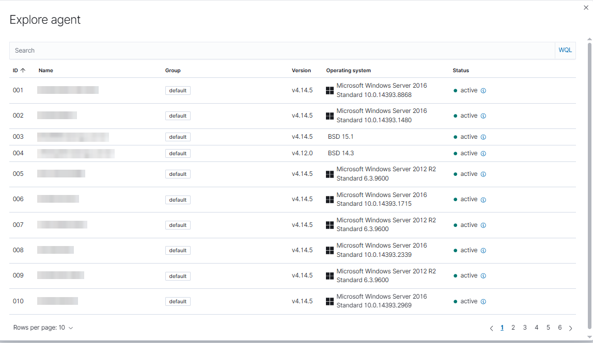<br><em>Figure 18 - Agent list</em></p>

<p align="center">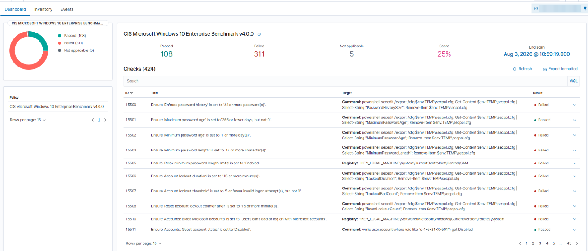<br><em>Figure 19 - Agent checks</em></p>

- **Passed / Failed / Not applicable:** checks met, not met and not applicable.
- **Score:** compliance percentage.
- **End scan:** time of the last assessment.

<p align="center">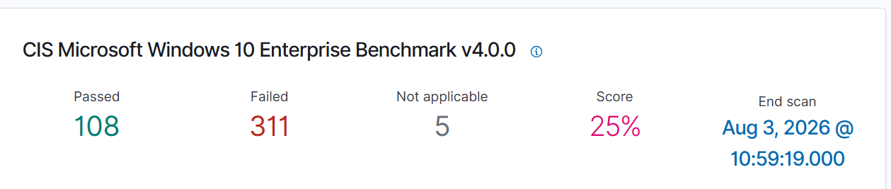<br><em>Figure 20 - Assessment header</em></p>

Each check shows **rationale**, **remediation**, **description**, **check** method and related **compliance** frameworks. The **Inventory** tab shows the benchmark, and **Events** records configuration changes.

<p align="center">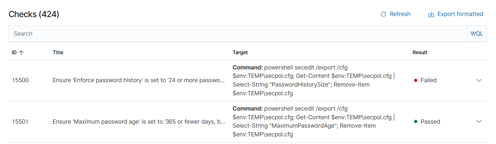<br><em>Figure 21 - Checks</em></p>

<p align="center">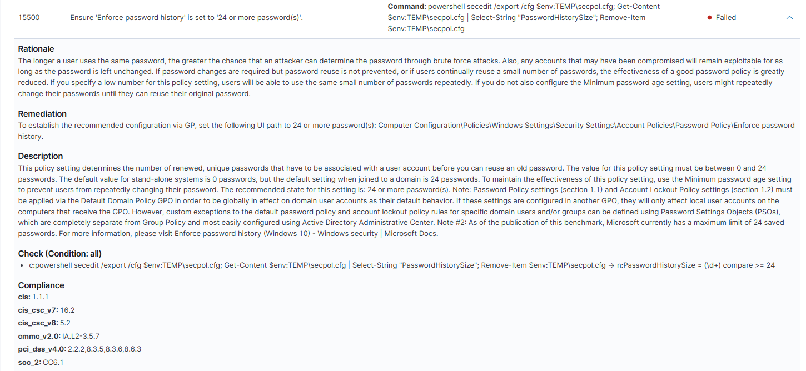<br><em>Figure 22 - Check details</em></p>

<p align="center">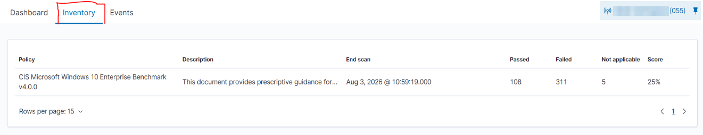<br><em>Figure 23 - Inventory</em></p>

<p align="center">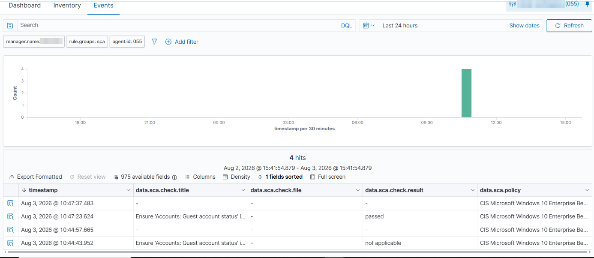<br><em>Figure 24 - Configuration change events</em></p>

### 5.3. Custom dashboards

Dashboards are under **Explore > Dashboards**. The full list and import instructions are in section 11.

<p align="center">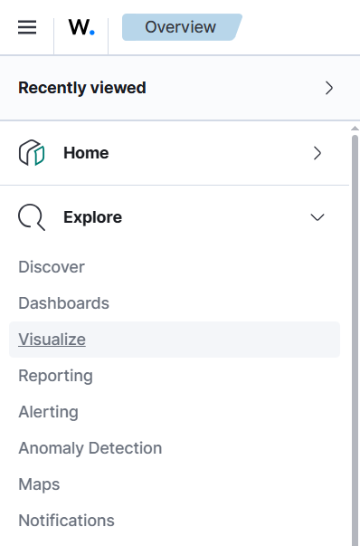<br><em>Figure 25 - Side menu with Dashboards, Alerting and Anomaly Detection</em></p>

---

## 6. Command-line administration

Rules, decoders, lists and ossec.conf are managed from the command line over SSH, by authorized users only.

```
ssh wazuh-user@192.0.2.10
sudo su
```

<p align="center">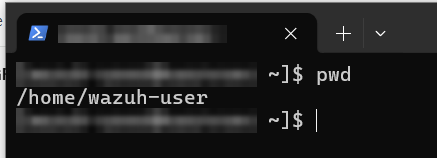<br><em>Figure 26 - SSH access</em></p>

<p align="center">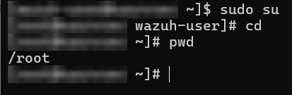<br><em>Figure 27 - Switching to root</em></p>

### 6.1. Custom rule structure

Built-in rules live in `/var/ossec/ruleset/rules/` and must **not** be edited (they are replaced on upgrades). Custom rules live in `/var/ossec/etc/rules/`.

#### 6.1.1. Load order: the most important detail

Wazuh merges rule files from **all directories** (built-in and custom) and loads them in **alphabetical order by file name**. Built-in files use prefixes `0010` to `0999`. A rule can only reference (`if_sid`, `if_matched_sid`, `if_matched_group`) a rule or group that has **already been loaded**.

That is why custom files use the **9NN** prefix (`901-`, `902-` …): they always load after the whole built-in ruleset, in the order of their ID ranges. `local_rules.xml` starts with a letter and loads **last**, which makes it the right place for catch-all rules.

> **Important:** A file named `03-errors.xml` loads **before** the built-in `0590-win-system_rules.xml` ("3" sorts before "5"). Its children of rule 61102 are dropped with **"Empty if_sid value. Rule will be ignored"**. Always use the 9NN prefix.

#### 6.1.2. Files and ID ranges

| File | ID range | Content |
|---|---|---|
| 901-iam-rules.xml | 100200-100299 | Active Directory identity management: users, computer accounts, groups, lockouts, sensitive attributes |
| 902-info-win-rules.xml | 100300-100399 | Informational Windows and SQL Server events |
| 903-erros-win-rules.xml | 100600-100699 | System log errors: TLS/Schannel, Netlogon, GPO, services, Administrator password attacks |
| 904-cisco-asa-rules.xml | 100700-100799 | Cisco ASA VPN: connections, errors, login failures, off-hours versions |
| 905-mssql-rules.xml | 100800-100899 | SQL Server login failures, brute force, off-hours failures |
| 906-openvpn-rules.xml | 100900-100999 | OpenVPN: logon, logoff, timeout, failures |
| 907-echos-system-rules.xml | 101000-101199 | Known-noise suppression, services, installs, critical user logoff |
| 908-abuse-rules.xml | 101200-101299 | External IPs in Suricata and scanning services (Modat.io) |
| 909-false-positive-rules.xml | 101500-101599 | False positives and agent health (event queue full) |
| 910-backup-rules.xml | 101600-101699 | Backup success and failure |
| 911-temp-rules.xml | 101700-101799 | Temporary test rules |
| 912-kaspersky-rules.xml | 101800-101899 | Antivirus: network attacks, malware, blocks, KSN, intrusion prevention |
| 913-forcepoint-rules.xml | 101900-101999 | DLP: violations, allowed and blocked data movements |
| 914-audit-rules.xml | 102000-102099 | Firewall audit: configuration, WebGUI, Squid, LDAP |
| 915-squid-rules.xml | 102100-102199 | Squid proxy: access and restricted sites |
| 916-suricata-rules.xml | 102200-102299 | Suricata protocol anomalies |
| 917-eol-rules.xml | 102300-102399 | End-of-life software and operating systems |
| 918-pfsense-filter-rules.xml | 102400-102499 | pfSense filter and IPs with repeated blocks |
| 919-cpu-usage-rules.xml | 102500-102599 | CPU usage and sustained high usage |
| 920-ram-usage-rules.xml | 102600-102699 | RAM usage |
| 921-hdd-rules.xml | 102700-102799 | Disk usage (daily e-mail above 90%) |
| 922-hdd-legacy-rules.xml | 102800-102899 | Disk usage on legacy Windows |
| 923-manage-wazuh-rules.xml | 102900-102999 | Wazuh server access: SSH, sudo, su, users, brute force |
| 924-monit-power-rules.xml | 103000-103099 | Manual and unexpected shutdowns |
| 925-adm-rules.xml | 103100-103199 | Windows administration: downloads, FIM, RDP, PsExec, suspicious processes, cached logon |
| local_rules.xml | 100000-100599, 101300-101499 | Windows authentication, RDP, webmail, critical users and master documentation (loaded last) |

File names may use hyphens or underscores but **must end in .xml**: files without the extension are silently ignored. Free range: **103200 onwards**.

#### 6.1.3. Header standard

```
<!--  ===========================================================================
Categoria: VPN - OpenVPN
Descrição: Regras de autenticação e sessão de usuários na VPN OpenVPN.
Dependência: decoder custom-openvpn

Faixa de IDs:
100900 - 100999
============================================================================= -->
```

> **Important:** XML comments **cannot contain two consecutive hyphens** (`--`). Separator lines made of dashes make the file invalid. Use `=` or `_`.

#### 6.1.4. Conventions

- **Sequential IDs**, in the order the rules appear, inside the reserved range.
- **Sibling rules** (same parent) are evaluated in order and the first match wins: put the most **specific** rule first.
- **Catch-all rules** (children without conditions) block every sibling loaded after them. Keep them at the end of the file.
- **Correlation rules** (`frequency`) count the **final** rule of each event. When an event can end in more than one rule, count by **group** (`if_matched_group`).
- **Time-based rules** (`<time>`) must be **children** of the normal rule, never siblings with the same condition.
- Events that more than one built-in rule may classify use an `if_sid` **list** (`60137, 67023`) with an explicit `eventID`.
- Dashboards and filters should use `rule.groups`, which does not change when rules are renumbered.

#### 6.1.5. Most used built-in parents

| Built-in rule | Event |
|---|---|
| 60106 | Successful logon (4624) |
| 67022 | Non-network, non-service logon (4624 types 2, 4, 7, 8, 10, 11, 13) |
| 60137 / 67023 | Logoff (4634): 60137 for type 3, 67023 for the others |
| 60122 | Failed logon (4625) |
| 67027 | Process creation (4688) |
| 61100 / 61101 / 61102 / 61103 | System log: information, warning, error, critical |
| 61138 / 92650 | Service created (7045) / service in %SystemRoot% (PsExec pattern) |
| 67018 | Shutdown initiated (1074) |
| 5710 / 5715 / 5716 / 5760 | SSH: unknown user, successful login, password failures |

```
grep -rn -A4 'rule id="611' /var/ossec/ruleset/rules/ | grep -E 'rule id|if_sid|description'
```

### 6.2. Testing rules

```
/var/ossec/bin/wazuh-analysisd -t   # load every rule and report errors
/var/ossec/bin/wazuh-logtest        # paste a real log line
```

wazuh-logtest shows **Phase 1** (pre-decoding), **Phase 2** (decoder and exact field names) and **Phase 3** (matched rule). Correlations can be tested by pasting several lines in the **same session**. If Phase 3 shows an old description, the new file has not been deployed yet.

### 6.3. Decoders

Decoders parse logs and extract the fields used by rules. Custom decoders live in `/var/ossec/etc/decoders`. Create one only when no built-in decoder fits. Fields from custom decoders are indexed as **text**, so numeric values (such as usage percentages) cannot be averaged in dashboards without a mapping change.

<p align="center">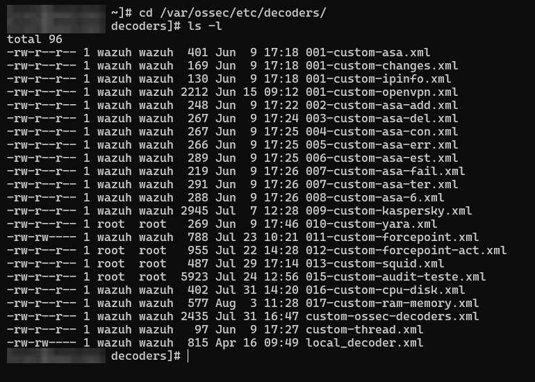<br><em>Figure 28 - Listing decoders</em></p>

### 6.4. CDB lists

Reference values (IPs, domains, users, hashes, processes) stored in `/var/ossec/etc/lists/` and registered in the `<ruleset>` block of ossec.conf. One entry per line ending with a colon; keys containing colons go between quotes.

<p align="center">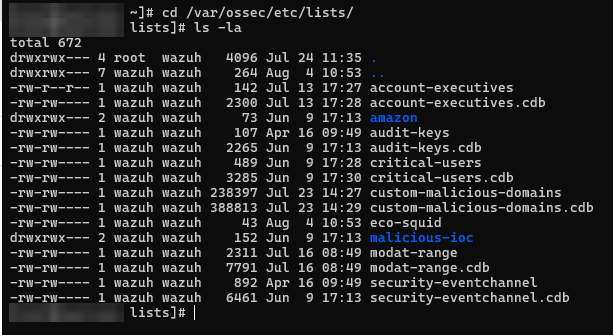<br><em>Figure 29 - CDB lists</em></p>

```
admin.user:
"www.example.com:443":
"C:\\Windows\\System32\\cmd.exe":shell
```

- `match_key` is an **exact** string match: `www.site.com:443` does not match `site.com:443`.
- Use `address_match_key` / `not_address_match_key` for IPs and networks.
- Windows paths arrive with **doubled backslashes**; lists must use the same format.

### 6.5. ossec.conf

<p align="center">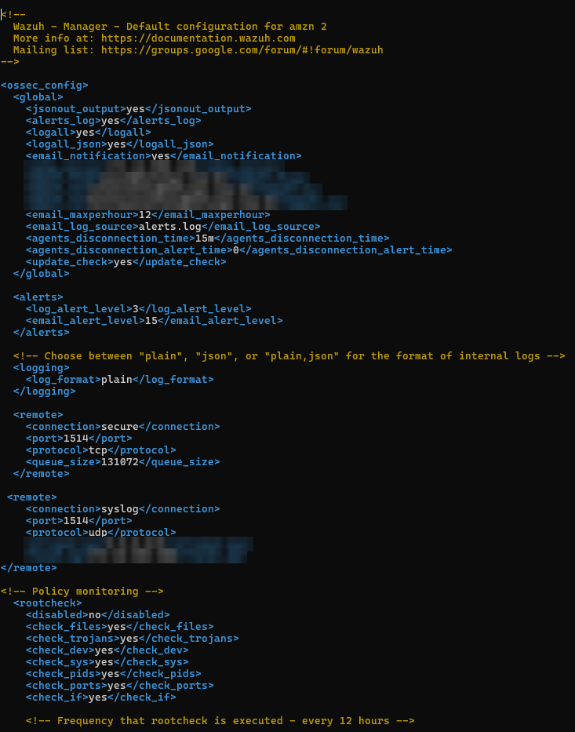<br><em>Figure 30 - ossec.conf</em></p>

> **Important:** Mistakes in ossec.conf can stop Wazuh from starting. Back it up, validate, document the change and restart only after validation.

| Block | Purpose |
|---|---|
| <global> | E-mail (`email_notification`, `smtp_server`, `email_from`, `email_to`) and general options. |
| <logall> / <logall_json> | Archive every received event. Greatly increases disk usage. |
| <alerts> | `log_alert_level` (minimum to store, default 3) and `email_alert_level` (minimum to e-mail, default 12). |
| <remote> | Agent communication (1514) and syslog (514). |
| <localfile> | Local log sources (files, journald, Event Channel, commands). |
| <ruleset> | Rule and decoder directories and CDB lists. |
| <integration> | External integrations (Slack, VirusTotal, custom scripts). |

### 6.6. Collecting journald

```
<localfile>
  <location>journald</location>
  <log_format>journald</log_format>
</localfile>
```

Keep a single source (journald **or** file) to avoid duplicate events.

## 7. Sensitive directories and files

| Path | Content and care |
|---|---|
| /var/ossec/ruleset/ | Built-in rules and decoders. Do not edit. |
| /var/ossec/etc/rules, decoders, lists | Customizations. Version and back up. |
| /var/ossec/etc/shared/ | Agent group configuration (agent.conf). |
| /var/ossec/logs/ | ossec.log, alerts/ and archives/. Essential for troubleshooting. |
| /var/ossec/etc/internal_options.conf | Do not edit: overwritten on upgrades. |
| /var/ossec/etc/local_internal_options.conf | Custom internal options go here. |
| /var/ossec/etc/sslmanager.key / .cert | Private key and certificate. Restricted access. |
| wazuh-install-files.tar | Installation passwords and certificates. Keep in a vault. |

---

## 8. Installing agents

Requirements: supported OS, administrative access, connectivity to the server on ports **1514** and **1515**, a standard agent name and a defined group. Agents must never be newer than the server.

### 8.1. From the Dashboard (recommended)

Go to **Endpoints > Deploy new agent**. The wizard generates the install command with server address, agent name and group.

<p align="center">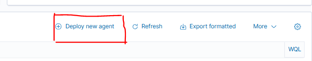<br><em>Figure 31 - Deploy new agent</em></p>

<p align="center">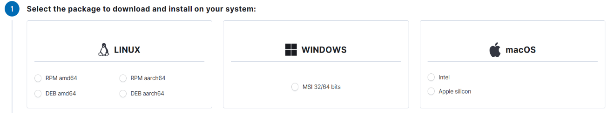<br><em>Figure 32 - Choosing the operating system</em></p>

<p align="center">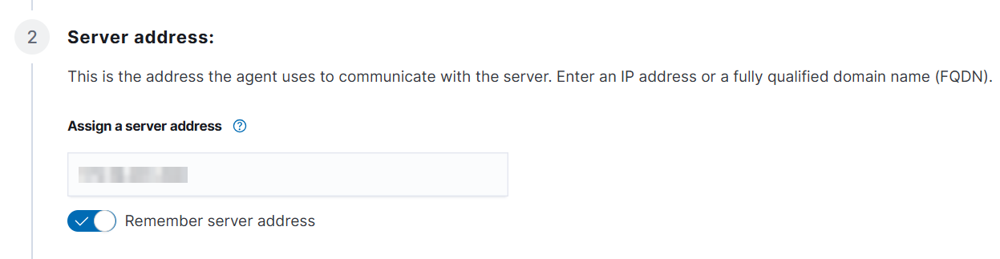<br><em>Figure 33 - Server address</em></p>

<p align="center">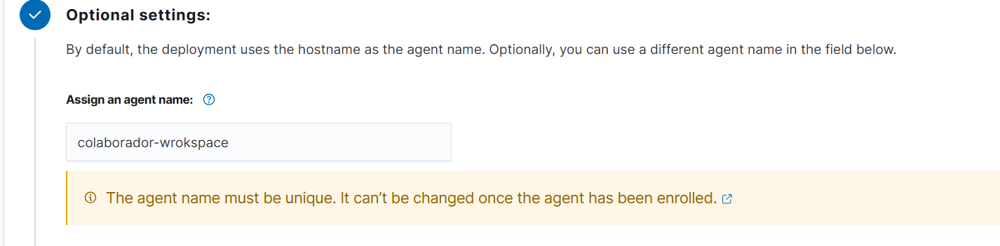<br><em>Figure 34 - Agent name</em></p>

> **Note:** The agent name must be **unique** and cannot be changed after enrollment.

<p align="center">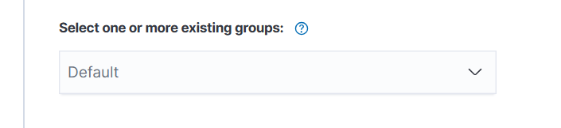<br><em>Figure 35 - Choosing groups</em></p>

Run the generated command in **PowerShell as Administrator** (Windows) or as root (Linux), then start the service:

<p align="center">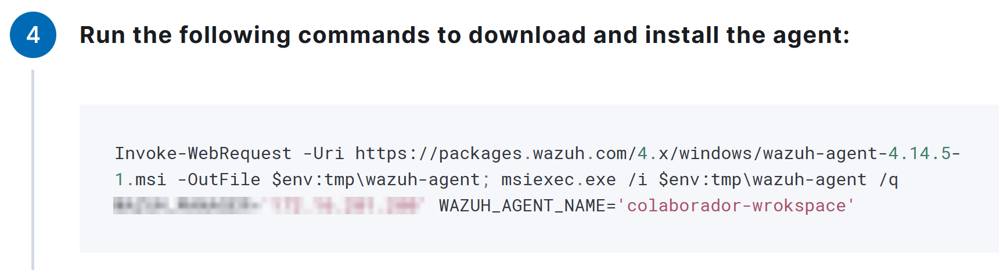<br><em>Figure 36 - Install command</em></p>

```
NET START Wazuh
```

<p align="center">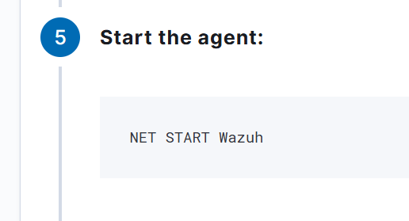<br><em>Figure 37 - Starting the agent</em></p>

### 8.2. From the website installer

Installer download: https://documentation.wazuh.com/current/installation-guide/wazuh-agent/index.html. Check the version: not every intermediate release is available.

<p align="center">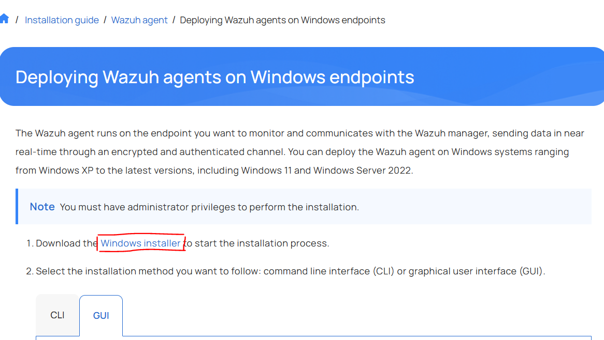<br><em>Figure 38 - Official agent installation page</em></p>

<p align="center">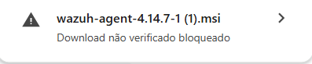<br><em>Figure 39 - .msi installer</em></p>

|  | Dashboard | Website installer |
|---|---|---|
| Connects to the server | Yes | No |
| Sets the group | Yes | No |
| Agent name | Custom | Machine hostname |
| Authentication key | Automatic | Manual |
| Extra configuration | No | Yes |

<p align="center">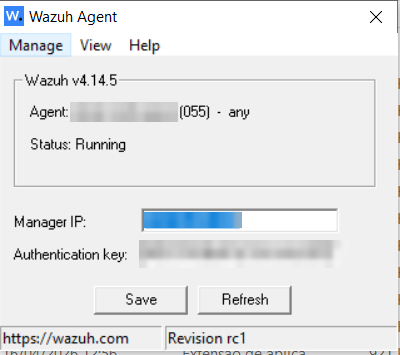<br><em>Figure 40 - Agent configured from the Dashboard</em></p>

<p align="center">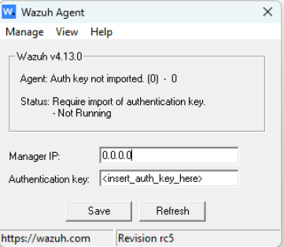<br><em>Figure 41 - Agent installed from .msi, not configured</em></p>

### 8.3. Manual enrollment on the server

```
/var/ossec/bin/manage_agents
```

Use **A** (Add agent) for name and IP and **E** (Extract key) for the key. Enter the key and server IP in the agent window and restart the service.

<p align="center">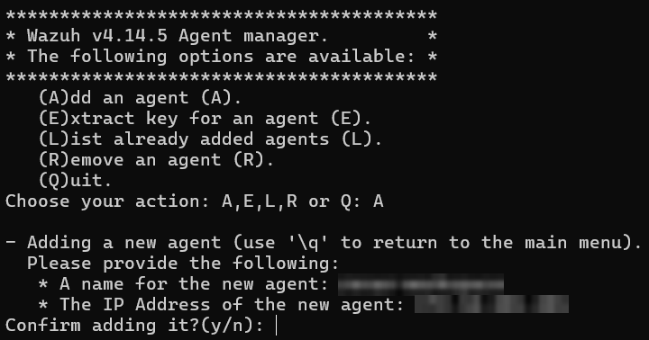<br><em>Figure 42 - Adding an agent</em></p>

<p align="center">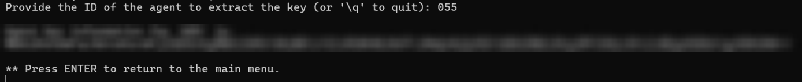<br><em>Figure 43 - Extracting the agent key</em></p>

> **Important:** The authentication key is a **credential**. Never share it or store it in documents, e-mail or chat.

---

## 9. Remote commands and group configuration

Each group `agent.conf` distributes configuration to its agents, including commands that run periodically (for example, to keep the Windows audit policy enabled).

> **Important:** Remote commands run as **SYSTEM** (Windows) or **root** (Linux) on every agent in the group. Apply them only to groups that need them, with tested and documented commands.

### 9.1. Enabling on the agent

```
logcollector.remote_commands=1
```

Add it to the agent `local_internal_options.conf` and restart the service (`wazuh_command.remote_commands=1` for the command wodle). The `scripts/` folder has a self-elevating `.bat` that does this; for unattended rollout use GPO or a SYSTEM scheduled task.

### 9.2. Configuring on the server

In **Agents management > Groups**, edit the group `agent.conf`, or edit `/var/ossec/etc/shared/<group>/agent.conf` from the CLI.

<p align="center">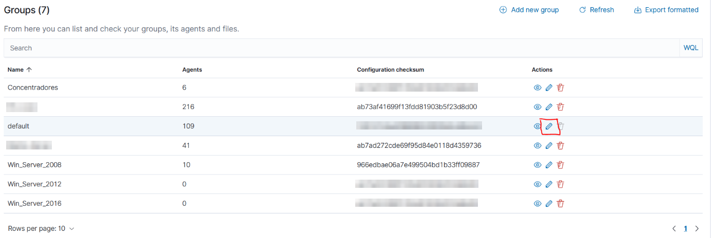<br><em>Figure 44 - Editing group configuration</em></p>

<p align="center">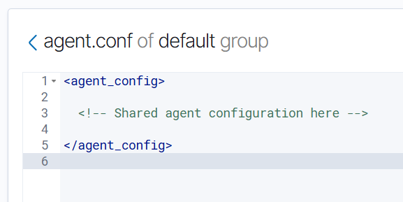<br><em>Figure 45 - Default agent.conf</em></p>

<p align="center">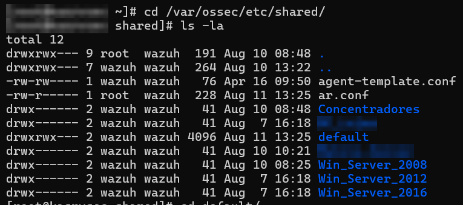<br><em>Figure 46 - Shared group configuration</em></p>

<p align="center">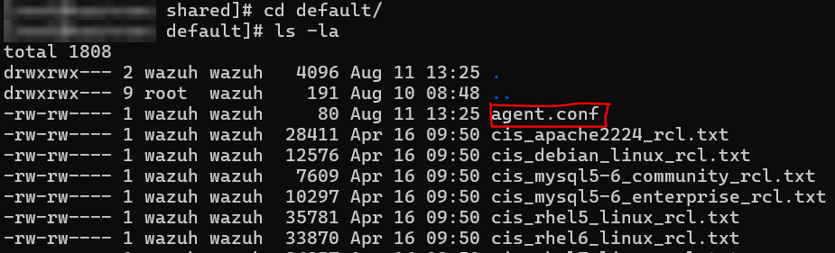<br><em>Figure 47 - Locating the group agent.conf</em></p>

<p align="center">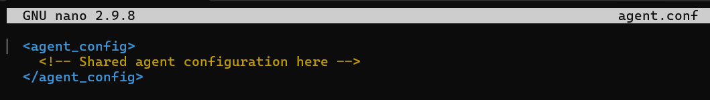<br><em>Figure 48 - Editing agent.conf from the CLI</em></p>

```
<agent_config>
  <localfile>
    <log_format>full_command</log_format>
    <command>auditpol /set /subcategory:{0CCE9215-69AE-11D9-BED3-505054503030} /success:enable /failure:enable</command>
    <alias>auditpol_logon</alias>
    <frequency>3600</frequency>
  </localfile>
</agent_config>
```

```
/var/ossec/bin/verify-agent-conf -f /var/ossec/etc/shared/<group>/agent.conf
/var/ossec/bin/agent_groups -S -i <AGENT_ID>
```

> **Warning:** The default `frequency` is 360 seconds and every run creates an event. Use intervals that match the need (hourly or daily). In a domain, prefer GPO for audit policy.

## 10. Agent groups

Groups organize agents and apply specific configuration. An agent can belong to **several groups**, and their configurations are merged.

<p align="center">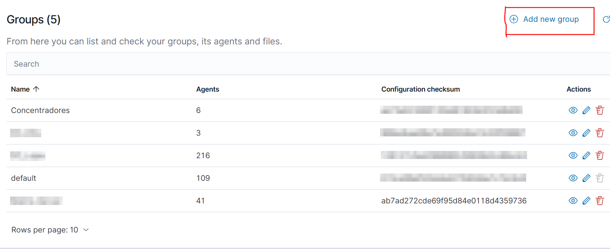<br><em>Figure 49 - Creating a group</em></p>

<p align="center">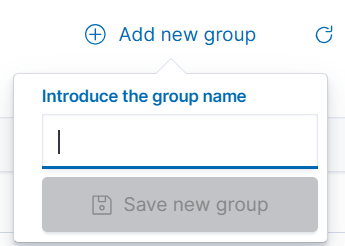<br><em>Figure 50 - Group name</em></p>

Open the group, click **Manage agents**, move agents between **Available agents** and **Current agents in the group** and click **Apply changes**.

<p align="center">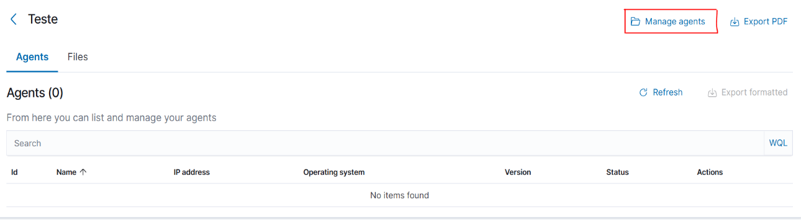<br><em>Figure 51 - Managing group agents</em></p>

<p align="center">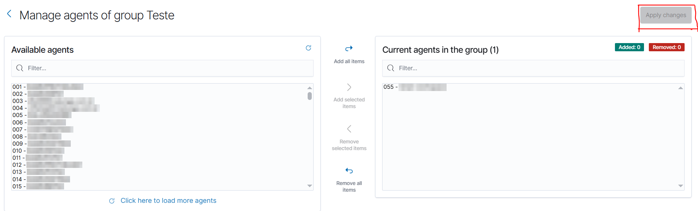<br><em>Figure 52 - Assigning agents</em></p>

<p align="center"><br><em>Figure 53 - Checking group membership</em></p>

---

## 11. Custom dashboards

Import the NDJSON files from `dashboards/` in **Dashboards Management > Saved Objects > Import** (enable overwrite). If asked for a missing index pattern, choose `wazuh-alerts-*`. Titles follow the **[CATEGORY] Subject** pattern (in Portuguese).

| Dashboard | Content |
|---|---|
| [AD] Gestão de Identidades | AD users, groups, computer accounts, lockouts, sensitive attributes |
| [ANTIVIRUS] Kaspersky | Network attacks, malware, blocks, KSN, intrusion prevention |
| [BANCO] SQL Server | Logins, failures, brute force, off-hours access |
| [DLP] Forcepoint | Violations, allowed and blocked movements |
| [FIREWALL] Auditoria / Tráfego e Bloqueios | Firewall configuration and WebGUI; IPs with repeated blocks |
| [GERAL] Visão Geral | Level 10+ alerts from every area (entry point) |
| [IDS] Suricata e Threat Intelligence | External IPs, signatures, anomalies, scans |
| [INFRA] Desempenho / Saúde e Manutenção | CPU, RAM, disk; backups, EOL, shutdowns, disconnected agents |
| [PROXY] Squid CD / Squid Matriz | Browsing, users, destinations, restricted sites |
| [VPN] Cisco ASA / OpenVPN | Connections, failures, off-hours events |
| [WAZUH] Acessos ao Manager | SSH, sudo, root sessions, brute force |
| [WINDOWS] Autenticação e RDP / Monitoramento Diário / Movimento Lateral e Processos | RDP and logon failures; services and audit policy; PsExec, LOLBins, masquerading |

## 12. Alerting and notifications

**Alerting** runs scheduled queries and notifies when a condition is met. It covers what rules cannot: **absence** of events (a backup did not run, a log source stopped) and **summaries**.

> **Warning:** These requests go to the **indexer**: use `/app/dev_tools#/console` or `curl -k -u admin https://localhost:9200/...`. The Server management Dev Tools talks to the Wazuh API and returns 404.

```
curl -k -u admin -X POST "https://localhost:9200/_plugins/_notifications/configs" \
  -H "Content-Type: application/json" -d @alerting/smtp-sender.json
curl -k -u admin -X POST "https://localhost:9200/_plugins/_notifications/configs" \
  -H "Content-Type: application/json" -d @alerting/canal-email-soc.json
curl -k -u admin -X POST "https://localhost:9200/_plugins/_alerting/monitors" \
  -H "Content-Type: application/json" -d @alerting/monitor-backup.json
```

The backup monitor runs daily at 9:00 and alerts when no successful backup was recorded in the last 26 hours. Test it with `POST _plugins/_alerting/monitors/<ID>/_execute?dryrun=true`. Other useful monitors: collection stopped (no alerts in 15 minutes), a log source stopped, a daily summary of restricted-site access and spikes of critical alerts.

For instant mobile notifications of specific rules, use a Wazuh **custom integration** (`<integration>` named `custom-…`, filtered by `rule_id`, `level` or `group`) calling a script that sends SMS (provider, Android gateway or Gammu modem) or a message (Telegram, ntfy). Limit it to a few critical rules and handle bursts.

## 13. Anomaly detection

**Anomaly Detection** learns the normal behavior of a metric and flags deviations. It works well for **frequent** events (failed logins per agent, proxy browsing per source IP, alert volume per agent, successful logins per user, DLP movements per user); rare events are better handled by rules. Use `timestamp`, a 10-minute interval and a 2-minute window delay, run a historical analysis to speed up training, and create an Alerting monitor for high anomaly grades.

---

## 14. Troubleshooting

#### 14.1. Rule file silently ignored

**Cause:** The name does not end in **.xml**.

**Fix:** Rename it to `.xml` and run `wazuh-analysisd -t`.

#### 14.2. "Signature ID X was not found" / "Empty if_sid value. Rule will be ignored"

**Cause:** The parent rule file loads **after** the child file. Files from all directories are sorted together by name; `03-…` loads before the built-in `0590-…`.

**Fix:** Use the **9NN** prefix and keep parents in lower-numbered files.

#### 14.3. "Group X was not found. Invalid if_group"

**Cause:** `if_matched_group` references a group defined by a rule loaded later.

**Fix:** Place the correlation after the rule that defines the group.

#### 14.4. Rule never fires, no error

**Cause:** Wrong field name case (`TargetUserName` instead of `targetUserName`) or missing field. Field names are case-sensitive.

**Fix:** Check the exact name in the alert details (Discover) or in wazuh-logtest Phase 2.

#### 14.5. Rule never fires, field is correct

**Cause:** An earlier sibling with the same or broader condition (or a catch-all) matches first.

**Fix:** Put the specific rule first; use wazuh-logtest to see which rule won.

#### 14.6. Off-hours rule never fires

**Cause:** It is a sibling of the normal rule with the same condition; the normal one always wins.

**Fix:** Make the time-based rule a **child** of the normal rule.

#### 14.7. Correlation (frequency) never fires

**Cause:** It counts the **final** rule of each event; if events end in a child rule, the counter does not move. Or the level is below 3.

**Fix:** Count by **group** (`if_matched_group`) and use level 3 or higher.

#### 14.8. Rule matches the wrong events

**Cause:** Unanchored regex: `^(1|1000)` matches any ID starting with 1; `5` matches 1500 or 7045.

**Fix:** Anchor values: `^(1|1000)$`, `^5$`.

#### 14.9. Windows path regex does not match

**Cause:** Paths arrive with **doubled backslashes**. In PCRE2, `\S`, `\C` and `\V` are tokens, not backslashes.

**Fix:** Use `\\+` for one or more backslashes.

#### 14.10. CDB list "could not be loaded"

**Cause:** Wrong path in ossec.conf (`etc/list/` instead of `etc/lists/`), `.txt` in the file name or missing read permission.

**Fix:** Fix `<list>`, remove the extension, set owner and permissions (wazuh:wazuh, 660).

#### 14.11. CDB list loads but never matches

**Cause:** `match_key` requires an exact match; the field has a port, path or different format. `match_key` does not handle IP ranges.

**Fix:** Match the list to the real field format; use `address_match_key` for IPs.

#### 14.12. Server SSH, sudo and PAM logs missing

**Cause:** The system logs only to journald.

**Fix:** Add the journald `<localfile>` (section 6.6).

#### 14.13. Dev Tools returns "404 - Not Found"

**Cause:** The request went to the **Wazuh API** console (Server management > Dev Tools), not to the indexer.

**Fix:** Use `/app/dev_tools#/console` or `curl -k -u admin https://localhost:9200/...`.

#### 14.14. agent.conf commands do not run

**Cause:** Agents reject remote commands by default.

**Fix:** Set `logcollector.remote_commands=1` (or `wazuh_command.remote_commands=1`) in the agent `local_internal_options.conf`.

#### 14.15. Dashboard shows odd data after renumbering rules

**Cause:** Old alerts keep their old IDs in the index.

**Fix:** Use periods after the change and prefer `rule.groups` filters.

#### 14.16. Alert missing from dashboards

**Cause:** Level below 3 (`log_alert_level`).

**Fix:** Raise it to 3 for visibility.

#### 14.17. Too many e-mails

**Cause:** Every alert at level 12+ is e-mailed; metrics collected every few minutes multiply this.

**Fix:** Use levels 10 and 11 for visibility without e-mail; send summaries for persistent states.

#### 14.18. One alert silences other agents

**Cause:** The `ignore` attribute applies to the whole rule, not per agent.

**Fix:** Keep `ignore` short or combine with `same_location`.

#### 14.19. Unknown indexer password (port 9200)

**Cause:** It is the dashboard admin password (default install) or it is in `wazuh-install-files.tar`.

**Fix:** If lost, reset it with the official password tool.

#### 14.20. RDP failure shows logon type 3

**Cause:** With **NLA**, credentials are validated before the session by network authentication; type 10 only appears with NLA disabled.

**Fix:** Treat type 3 failures as network authentication (RDP, SMB and others). For RDP-only, collect event 140 from the RdpCoreTS channel.

---

## 15. Credits and references

**Wazuh** is developed and maintained by **Wazuh Inc.** and its open source community. Thanks to the Wazuh team for the platform, the built-in rules and decoders, and the official documentation that made this work possible.

> **Note:** This manual is **not official Wazuh material** and is not endorsed by Wazuh Inc. Validate every procedure against the official documentation for your version.

- Official documentation: https://documentation.wazuh.com
- Installation guide: https://documentation.wazuh.com/current/installation-guide/
- Rules syntax: https://documentation.wazuh.com/current/user-manual/ruleset/ruleset-xml-syntax/rules.html
- Community: https://wazuh.com/community/
- MITRE ATT&CK: https://attack.mitre.org
- OpenSearch Alerting and Anomaly Detection: https://opensearch.org/docs/latest/
