# Manual Wazuh: instalação, regras customizadas, dashboards e alertas

🇧🇷 Português | [🇺🇸 English](README.en.md)

> **Material não oficial.** Este repositório não é documentação oficial do Wazuh e não é endossado pela Wazuh Inc. Os créditos da plataforma pertencem à equipe do Wazuh e à sua comunidade. Consulte sempre https://documentation.wazuh.com.

## Estrutura do repositório

| Pasta | Conteúdo |
|---|---|
| `rules/` | 26 arquivos de regras customizadas (prefixo 9NN + `local_rules.xml`) |
| `lists/` | Listas CDB de exemplo |
| `dashboards/` | 18 dashboards em NDJSON para importar (arquivo único `00-` ou um por dashboard) |
| `alerting/` | Canal de e-mail e monitor de backup para o Alerting |
| `agent/` | `agent.conf` de exemplo (política de auditoria do Windows) |
| `scripts/` | Script `.bat` para habilitar comandos remotos nos agentes Windows |
| `docs/images/` | Capturas de tela usadas no manual |

### Uso rápido das regras

```bash
cp rules/*.xml /var/ossec/etc/rules/
cp lists/lolbins_vigiados /var/ossec/etc/lists/
chown wazuh:wazuh /var/ossec/etc/rules/*.xml /var/ossec/etc/lists/*
chmod 660 /var/ossec/etc/rules/*.xml
/var/ossec/bin/wazuh-analysisd -t   # valide antes de reiniciar
systemctl restart wazuh-manager
```

Antes de usar, ajuste as **redes internas**, as **listas CDB** e os **nomes de decoders** ao seu ambiente, e registre as listas no `ossec.conf` (seção 6.4). As regras dependem de decoders customizados para fontes como Cisco ASA, OpenVPN, Kaspersky, Forcepoint e Squid; regras sem o decoder correspondente simplesmente não disparam.

## Sumário

- [1. Sobre o Wazuh](#1-sobre-o-wazuh)
  - [1.1. Componentes da plataforma](#11-componentes-da-plataforma)
- [2. Instalação do Wazuh](#2-instalação-do-wazuh)
  - [2.1. Requisitos de hardware (servidor único)](#21-requisitos-de-hardware-servidor-único)
  - [2.2. Portas utilizadas](#22-portas-utilizadas)
  - [2.3. Instalação rápida (servidor único)](#23-instalação-rápida-servidor-único)
  - [2.4. Pós-instalação recomendada](#24-pós-instalação-recomendada)
  - [2.5. Atualização](#25-atualização)
- [3. Acesso à Interface Gráfica (GUI)](#3-acesso-à-interface-gráfica-gui)
  - [3.1. Acessando o ambiente de monitoramento](#31-acessando-o-ambiente-de-monitoramento)
- [4. Navegação pelas telas](#4-navegação-pelas-telas)
  - [4.1. Agent Summary](#41-agent-summary)
  - [4.2. Last 24 Hours Alerts](#42-last-24-hours-alerts)
  - [4.3. Endpoint Security](#43-endpoint-security)
  - [4.4. Threat Intelligence](#44-threat-intelligence)
  - [4.5. Security Operations](#45-security-operations)
  - [4.6. Cloud Security](#46-cloud-security)
- [5. Monitoramento diário](#5-monitoramento-diário)
  - [5.1. Threat Hunting](#51-threat-hunting)
  - [5.2. Configuration Assessment](#52-configuration-assessment)
  - [5.3. Dashboards personalizados](#53-dashboards-personalizados)
- [6. Administração via CLI](#6-administração-via-cli)
  - [6.1. Estrutura das regras customizadas](#61-estrutura-das-regras-customizadas)
  - [6.2. Testando regras: wazuh-logtest e validação](#62-testando-regras-wazuh-logtest-e-validação)
  - [6.3. Decoders](#63-decoders)
  - [6.4. Listas CDB](#64-listas-cdb)
  - [6.5. Arquivo ossec.conf](#65-arquivo-ossecconf)
  - [6.6. Coleta de logs do journald](#66-coleta-de-logs-do-journald)
- [7. Diretórios e arquivos sensíveis](#7-diretórios-e-arquivos-sensíveis)
- [8. Instalação de agentes](#8-instalação-de-agentes)
  - [8.1. Instalação pelo Dashboard (recomendada)](#81-instalação-pelo-dashboard-recomendada)
  - [8.2. Instalação pelo instalador do site](#82-instalação-pelo-instalador-do-site)
  - [8.3. Cadastro manual do agente no servidor](#83-cadastro-manual-do-agente-no-servidor)
- [9. Comandos remotos e configuração por grupo](#9-comandos-remotos-e-configuração-por-grupo)
  - [9.1. Habilitando no agente](#91-habilitando-no-agente)
  - [9.2. Configurando no servidor](#92-configurando-no-servidor)
- [10. Gerenciamento de grupos de agentes](#10-gerenciamento-de-grupos-de-agentes)
  - [10.1. Criando um grupo](#101-criando-um-grupo)
  - [10.2. Adicionando agentes](#102-adicionando-agentes)
- [11. Dashboards personalizados](#11-dashboards-personalizados)
- [12. Alerting e notificações](#12-alerting-e-notificações)
  - [12.1. Canal de e-mail](#121-canal-de-e-mail)
  - [12.2. Monitor de backup não executado](#122-monitor-de-backup-não-executado)
  - [12.3. Outros monitores recomendados](#123-outros-monitores-recomendados)
  - [12.4. Notificação no celular](#124-notificação-no-celular)
- [13. Detecção de anomalias](#13-detecção-de-anomalias)
- [14. Problemas comuns e soluções](#14-problemas-comuns-e-soluções)
- [15. Créditos e referências](#15-créditos-e-referências)

> **Nota:** **Material não oficial.** Este manual é um trabalho independente, produzido a partir da experiência de uso do Wazuh em produção. Ele **não é** documentação oficial do Wazuh, não é revisado nem endossado pela Wazuh Inc. e pode ficar desatualizado em relação às novas versões. Sempre confira a documentação oficial em https://documentation.wazuh.com antes de aplicar qualquer procedimento em produção.

**Créditos:** o Wazuh é um projeto de código aberto mantido pela **Wazuh Inc.** e por sua comunidade. Todo o mérito da plataforma, das regras nativas, dos decoders e da documentação oficial pertence a eles. Os nomes e logotipos do Wazuh são marcas de seus respectivos titulares. Este material apenas descreve uma forma de usar e estender a plataforma.

**Ambiente de referência:** Wazuh 4.14 (instalação em servidor único, família Red Hat), agentes Windows e Linux, fontes de log como Active Directory, SQL Server, VPN (Cisco ASA e OpenVPN), proxy Squid, pfSense, Suricata, antivírus e DLP. Todos os endereços, nomes e domínios deste manual são **exemplos** e devem ser substituídos pelos do seu ambiente.

## 1. Sobre o Wazuh

O Wazuh é uma plataforma de segurança de código aberto voltada ao monitoramento de ambientes, à detecção de ameaças, à resposta a incidentes e ao gerenciamento de eventos de segurança. A solução reúne recursos de **SIEM (Security Information and Event Management)** e **XDR (Extended Detection and Response)**, permitindo coletar, processar, analisar e correlacionar informações de diferentes sistemas operacionais, aplicações e equipamentos de rede, com uma visão centralizada do ambiente.

Além do monitoramento contínuo, o Wazuh permite criar e customizar regras de detecção, integrar-se a outras soluções de segurança e gerar alertas para eventos relevantes. Ele pode monitorar ambientes **Windows, Linux e macOS**, dispositivos de rede, serviços em nuvem e aplicações corporativas.

### 1.1. Componentes da plataforma

| Componente | Função |
|---|---|
| **Wazuh Agent** | Instalado nos ativos monitorados. Coleta logs, eventos, inventário e dados de integridade e envia ao servidor. |
| **Wazuh Server (Manager)** | Recebe os eventos, aplica **decoders** e **regras**, gera os alertas e gerencia os agentes. É onde ficam as regras customizadas. |
| **Wazuh Indexer** | Banco de dados (baseado em OpenSearch) que armazena e indexa os alertas para consulta. |
| **Wazuh Dashboard** | Interface web para análise, dashboards, Alerting, Anomaly Detection e administração. |

O caminho de um evento é sempre o mesmo: o **agente** coleta, o **decoder** interpreta e extrai os campos, a **regra** decide se aquilo vira alerta e com qual nível, o **indexer** armazena e o **dashboard** exibe. Entender esse caminho é a chave para quase todos os problemas descritos na seção de solução de problemas.

---

## 2. Instalação do Wazuh

A forma mais simples de instalação é a **instalação rápida** (quickstart), que instala o indexer, o servidor e o dashboard em uma única máquina por meio de um assistente oficial. Ambientes maiores devem usar a **instalação distribuída** (cada componente em servidores separados), descrita na documentação oficial.

> **Atenção:** Comandos, versões e requisitos mudam entre versões do Wazuh. Antes de instalar, confira o guia oficial em https://documentation.wazuh.com/current/installation-guide/

### 2.1. Requisitos de hardware (servidor único)

A documentação oficial orienta o dimensionamento pela quantidade de agentes, considerando cerca de 90 dias de alertas armazenados:

| Agentes | vCPU | RAM | Disco |
|---|---|---|---|
| Até 25 | 4 | 8 GB | 50 GB |
| 25 a 50 | 8 | 8 GB | 100 GB |
| 50 a 100 | 8 | 8 GB | 200 GB |
| Acima de 100 | Instalação distribuída |  |  |

Sistemas suportados: distribuições Linux de 64 bits, como Red Hat/Rocky/Alma, Amazon Linux, Ubuntu e Debian, em versões ainda suportadas pelo fornecedor.

### 2.2. Portas utilizadas

| Porta | Protocolo | Uso |
|---|---|---|
| 443 | TCP | Wazuh Dashboard (acesso web) |
| 1514 | TCP | Comunicação dos agentes com o servidor |
| 1515 | TCP | Cadastro (enrollment) de agentes |
| 514 | TCP/UDP | Recebimento de syslog (firewalls, appliances), se habilitado |
| 55000 | TCP | API do Wazuh (servidor) |
| 9200 | TCP | Wazuh Indexer (API do OpenSearch) |

Em servidores da família Red Hat com firewalld, libere as portas necessárias:

```
firewall-cmd --permanent --add-port={443,1514,1515,55000}/tcp
firewall-cmd --permanent --add-port=514/udp
firewall-cmd --reload
```

### 2.3. Instalação rápida (servidor único)

Execute como **root** no servidor que receberá o Wazuh. O caminho contém a linha de versão (4.x):

```
curl -sO https://packages.wazuh.com/4.x/wazuh-install.sh
sudo bash ./wazuh-install.sh -a
```

O parâmetro `-a` instala todos os componentes. Ao final, o assistente exibe o endereço do dashboard, o usuário **admin** e a senha gerada, e cria o arquivo **wazuh-install-files.tar** com todas as senhas e certificados.

> **Importante:** Guarde o **wazuh-install-files.tar** em local seguro (cofre de senhas ou backup protegido). Ele contém todas as credenciais do ambiente. Não o deixe esquecido no servidor nem o envie por e-mail.

Para consultar as senhas geradas:

```
tar -O -xvf wazuh-install-files.tar wazuh-install-files/wazuh-passwords.txt
```

Numa instalação padrão, o usuário **admin** do dashboard é o mesmo usuário **admin** do indexer (porta 9200). As senhas do indexer ficam gravadas em hash: se forem perdidas, não podem ser lidas, apenas redefinidas com a ferramenta oficial de senhas, que atualiza todos os componentes juntos.

### 2.4. Pós-instalação recomendada

1. **Trocar as senhas padrão** com a ferramenta oficial (`wazuh-passwords-tool.sh`), seguindo o guia da versão instalada.
2. **Ajustar o fuso horário** do servidor (`timedatectl set-timezone America/Sao_Paulo`). As regras com horário (`<time>`) usam o horário do servidor.
3. **Configurar o e-mail** no bloco `<global>` do `/var/ossec/etc/ossec.conf` (`email_notification`, `smtp_server`, `email_from`, `email_to`). O envio nativo não suporta autenticação SMTP; use um servidor que aceite envio sem senha a partir do IP do servidor (relay interno ou Postfix local).
4. **Coletar os logs do próprio servidor.** Em distribuições recentes (como RHEL 9 mínimo), os logs de SSH, sudo e PAM podem ir apenas para o **journald**, sem `/var/log/secure`. Nesse caso, adicione a coleta do journald (veja a seção 6.6).
5. **Criar a estrutura de regras customizadas** conforme a seção 6 (prefixos de arquivo, faixas de IDs e cabeçalhos).
6. **Fazer backup** de `/var/ossec/etc/` (ossec.conf, regras, decoders, listas e `shared/`) antes de qualquer alteração e periodicamente.

### 2.5. Atualização

Antes de atualizar: faça backup de `/var/ossec/etc/`, leia as notas de versão e atualize na ordem recomendada pela documentação (indexer, servidor, dashboard e, por último, agentes). Regras e decoders customizados em `/var/ossec/etc/` são preservados; arquivos nativos em `/var/ossec/ruleset/` são substituídos.

---

## 3. Acesso à Interface Gráfica (GUI)

### 3.1. Acessando o ambiente de monitoramento

Abra um navegador e informe, na barra de endereços, o **endereço IP ou o nome do host do Wazuh Dashboard**. Na página de autenticação, informe suas credenciais.

<p align="center">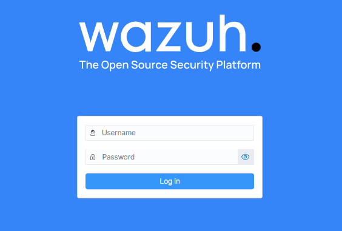<br><em>Figura 1 - Tela de acesso inicial</em></p>

**Exemplo:** https://192.0.2.10

Recomenda-se que cada analista tenha sua **conta individual**, com o perfil de acesso adequado à função, e que o compartilhamento de credenciais seja proibido pela política interna.

Após a autenticação, será exibida a tela inicial do **Wazuh Dashboard**.

<p align="center">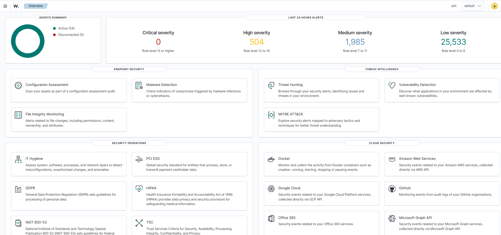<br><em>Figura 2 - Tela inicial do Wazuh</em></p>

## 4. Navegação pelas telas

### 4.1. Agent Summary

Apresenta um resumo do estado dos agentes cadastrados, com a quantidade de agentes **ativos e desconectados**, permitindo identificar rapidamente ativos que deixaram de se comunicar.

<p align="center">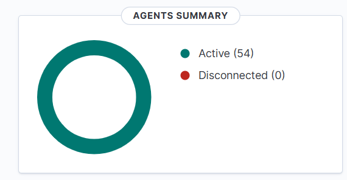<br><em>Figura 3 - Resumo dos agentes</em></p>

### 4.2. Last 24 Hours Alerts

Resume os alertas gerados nas últimas 24 horas, classificados pelo nível de severidade atribuído pelas regras:

- **Baixa severidade, níveis 0 a 6:** eventos informativos ou de baixo impacto.
- **Média severidade, níveis 7 a 11:** comportamentos incomuns que requerem análise.
- **Alta severidade, níveis 12 a 14:** atividades potencialmente maliciosas, com investigação prioritária. A partir do nível 12, o Wazuh envia e-mail automaticamente (configuração `email_alert_level`).
- **Crítica, nível 15:** risco elevado, tratamento imediato.

<p align="center">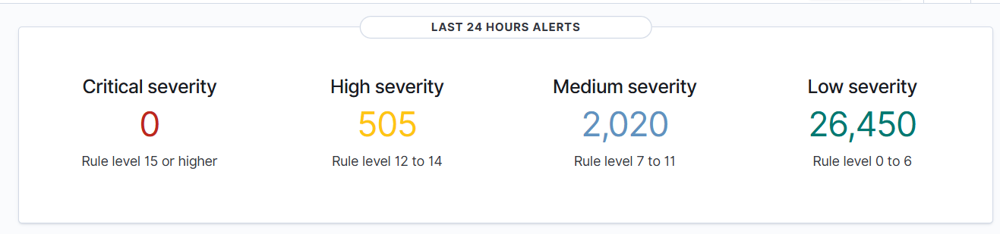<br><em>Figura 4 - Severidade dos alertas</em></p>

> **Nota:** Alertas abaixo do nível 3 **não são gravados** no índice (configuração `log_alert_level`). Regras de nível 0 a 2 servem para silenciar ruído e não aparecem nos dashboards.

### 4.3. Endpoint Security

Reúne recursos de monitoramento e análise de segurança dos endpoints.

<p align="center">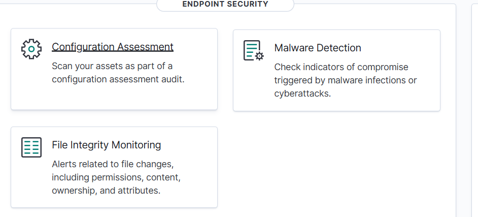<br><em>Figura 5 - Menu Endpoint Security</em></p>

- **Configuration Assessment:** avalia as configurações dos ativos frente a benchmarks como os **CIS Benchmarks**, apontando desvios das boas práticas.
- **Malware Detection:** apresenta indicadores de comprometimento (IOCs) e indícios de atividades maliciosas nos agentes.
- **File Integrity Monitoring (FIM):** monitora alterações em conteúdo, permissões, atributos e proprietário de arquivos e diretórios configurados.

### 4.4. Threat Intelligence

<p align="center">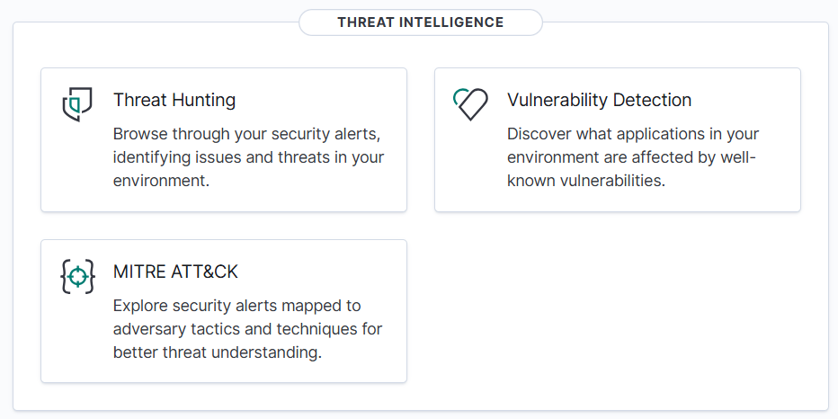<br><em>Figura 6 - Menu Threat Intelligence</em></p>

- **Threat Hunting:** consulta, filtra e investiga eventos e alertas por nível, agente, grupo, regra, data e horário.
- **Vulnerability Detection:** identifica vulnerabilidades conhecidas (CVE) nos softwares inventariados nos agentes. Uma vulnerabilidade identificada não significa que o ativo está comprometido; o resultado deve ser avaliado no contexto do ativo.
- **MITRE ATT&CK:** associa os alertas às táticas e técnicas da matriz MITRE ATT&CK. A associação apoia a análise, mas não confirma por si só que a técnica foi executada.

### 4.5. Security Operations

Reúne funcionalidades de postura de segurança e conformidade: **IT Hygiene** (usuários, softwares e processos dos endpoints), **PCI DSS**, **GDPR**, **HIPAA**, **NIST SP 800-53** e **TSC**. Os resultados apoiam auditorias e processos de conformidade, mas **não substituem** auditorias formais nem comprovam, isoladamente, o atendimento a nenhuma norma.

<p align="center">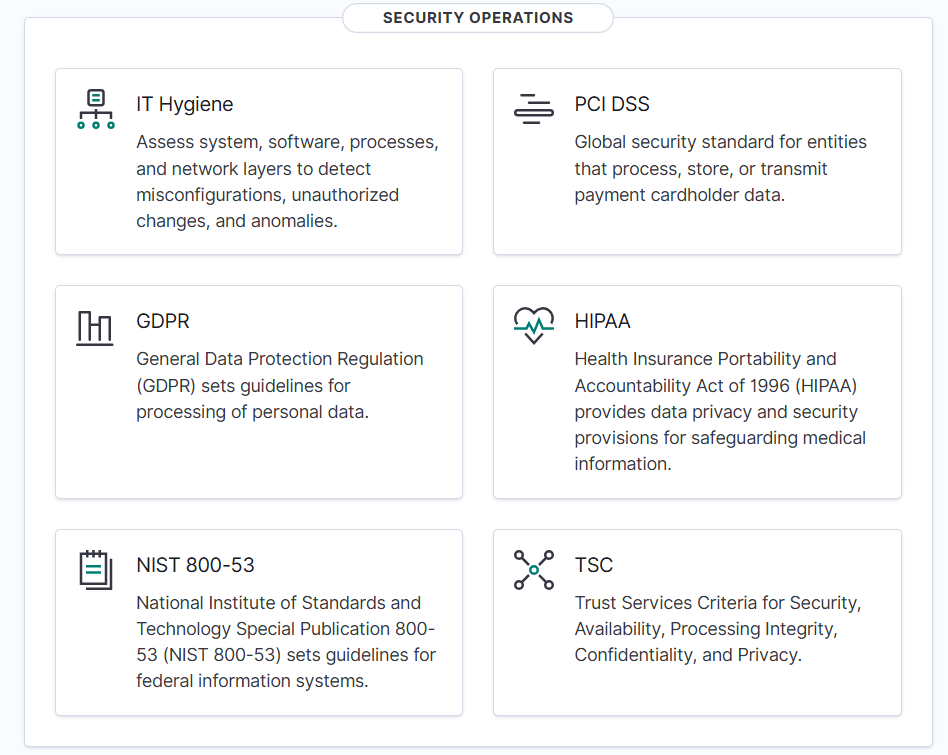<br><em>Figura 7 - Menu Security Operations</em></p>

### 4.6. Cloud Security

Centraliza eventos de serviços em nuvem e SaaS integrados: **Docker, AWS, Google Cloud, GitHub, Office 365** e **Microsoft Graph API**. O escopo depende das integrações, permissões e fontes de dados configuradas em cada serviço.

<p align="center">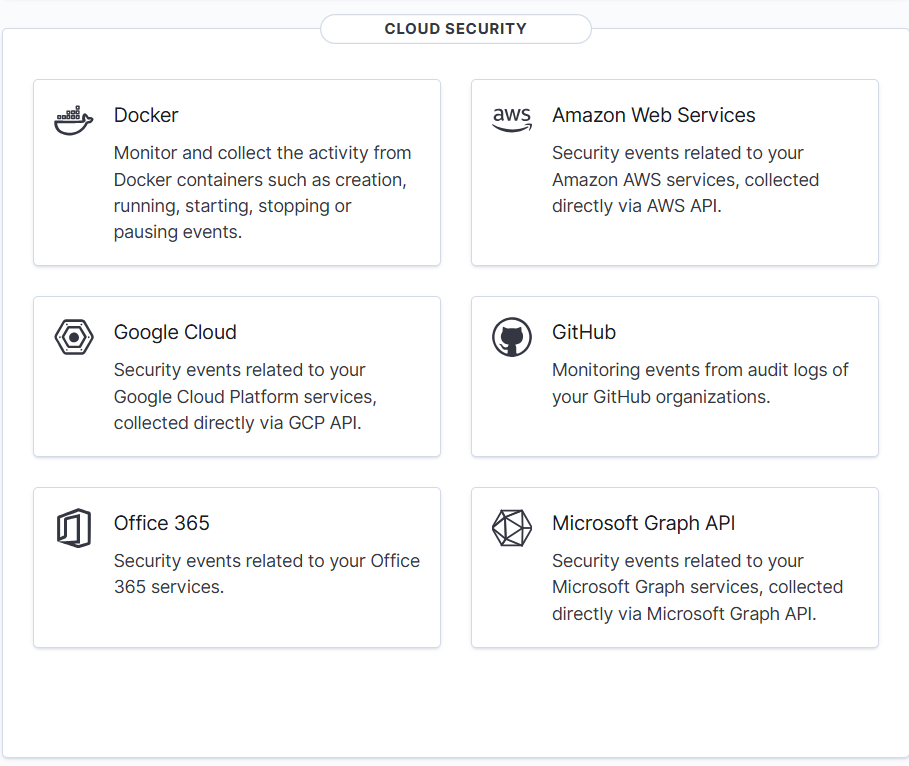<br><em>Figura 8 - Menu Cloud Security</em></p>

---

## 5. Monitoramento diário

No dia a dia, os recursos mais usados são o **Threat Hunting**, o **Configuration Assessment**, os **Dashboards** personalizados e os avisos do **Alerting**.

### 5.1. Threat Hunting

<p align="center">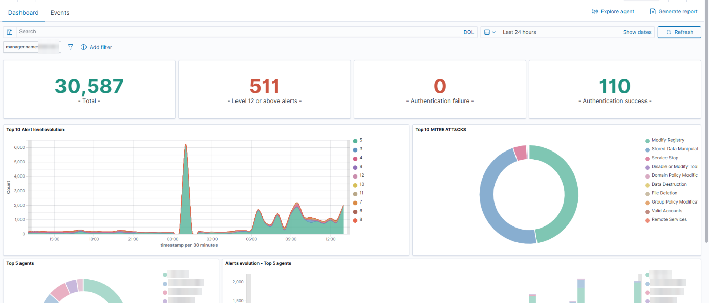<br><em>Figura 9 - Painel inicial do Threat Hunting</em></p>

Ao acessar o Threat Hunting, é exibido um resumo dos eventos do período selecionado (padrão: últimas 24 horas). Na aba **Events** ficam os eventos, conforme o período e os filtros aplicados.

<p align="center">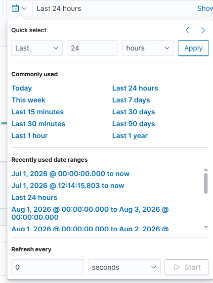<br><em>Figura 10 - Configuração do intervalo de tempo</em></p>

- **Quick Select:** seleção rápida de intervalos predefinidos.
- **Commonly Used:** intervalos mais usados.
- **Recently Used Date Ranges:** histórico dos últimos intervalos.
- **Refresh Every:** atualização automática da tela.

> **Atenção:** Configure o **Refresh Every** com no mínimo **1 minuto**. Intervalos menores aumentam as consultas ao indexer e podem afetar o desempenho do servidor.

#### 5.1.1. Visualização dos eventos

<p align="center">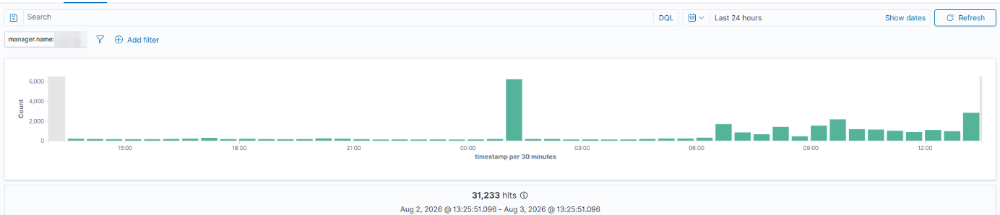<br><em>Figura 11 - Gráfico geral dos eventos</em></p>

Abaixo do gráfico fica a tabela de eventos. Os principais campos são **timestamp**, **agent.name**, **rule.description**, **rule.level** e **rule.id**.

<p align="center">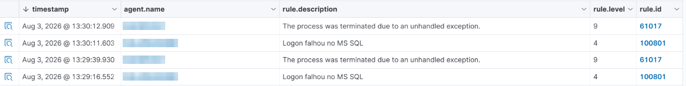<br><em>Figura 12 - Tabela de alertas</em></p>

#### 5.1.2. Visualização dos detalhes

Para ver os detalhes de um evento, clique no **ícone de expansão** na primeira coluna da tabela.

<p align="center">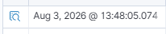<br><em>Figura 13 - Abrindo os detalhes do alerta</em></p>

Será aberto um painel lateral com todos os campos do alerta. É nele que se descobre o **nome exato dos campos** (por exemplo, `data.win.eventdata.targetUserName`), informação essencial para criar regras, filtros e dashboards.

<p align="center">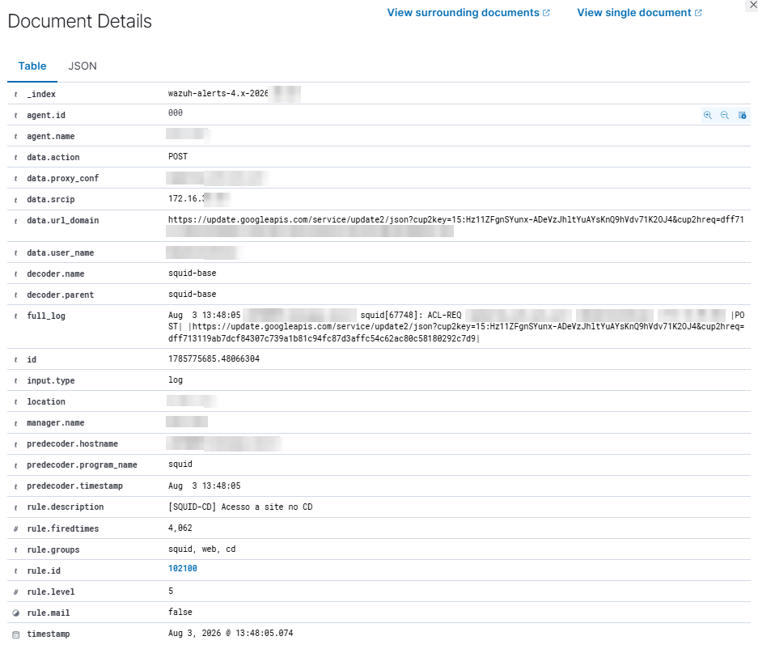<br><em>Figura 14 - Detalhes do alerta (tabela)</em></p>

<p align="center">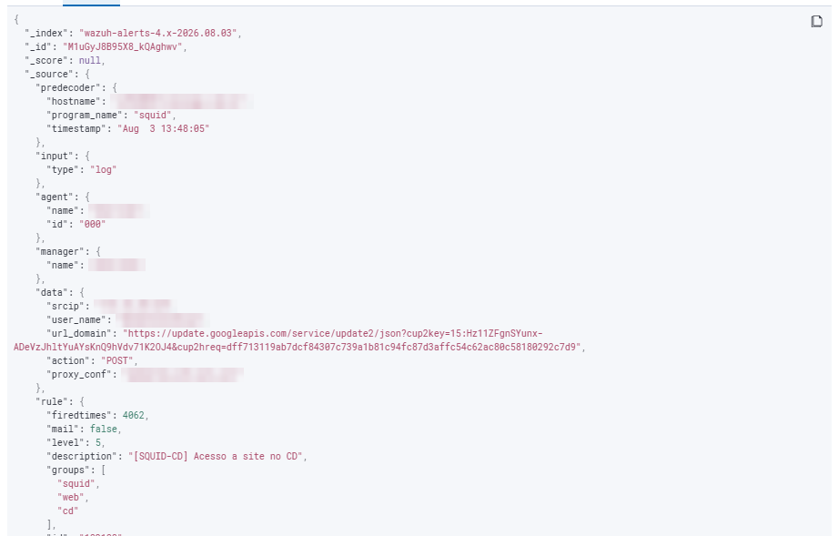<br><em>Figura 15 - Detalhes do alerta em JSON</em></p>

Na parte superior do painel, **View single document** abre o alerta em uma nova janela e **View surrounding documents** abre o Discover com os eventos próximos no tempo, úteis para entender o contexto.

<p align="center"><br><em>Figura 16 - Abrindo os detalhes em outras janelas</em></p>

### 5.2. Configuration Assessment

Avalia as configurações dos ativos frente aos **CIS Benchmarks**.

> **Atenção:** As recomendações do CIS são boas práticas e **não devem ser aplicadas de forma indiscriminada**. Cada recomendação deve considerar as necessidades operacionais e as políticas da organização. Um desvio não é, necessariamente, uma vulnerabilidade.

<p align="center">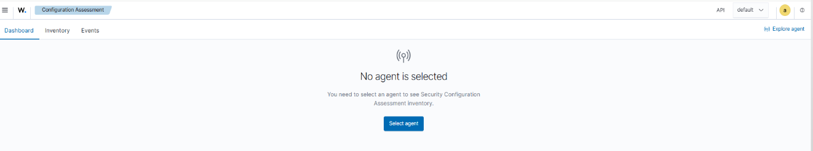<br><em>Figura 17 - Selecionar o agente</em></p>

A avaliação é feita por agente. Selecione o ativo em **Explore agent** (topo da tela) ou **Select agent** (centro da página).

<p align="center">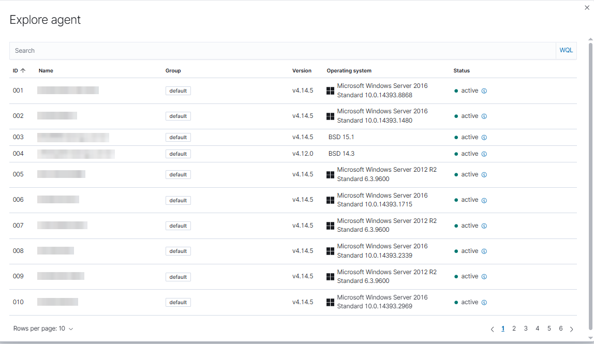<br><em>Figura 18 - Selecionando o agente</em></p>

<p align="center">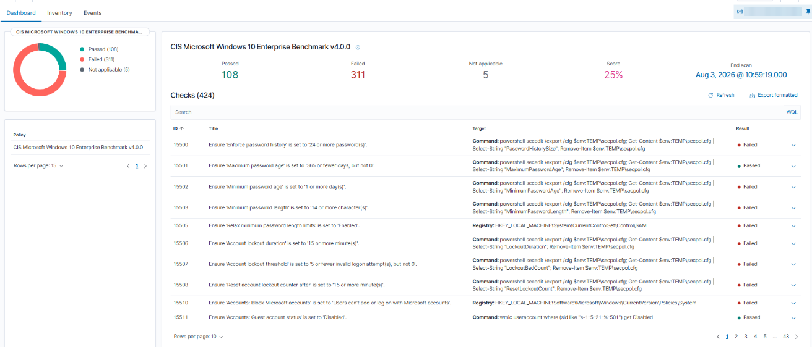<br><em>Figura 19 - Checagens do agente</em></p>

No topo aparecem o benchmark aplicado e as métricas da última verificação:

- **Passed:** verificações atendidas.
- **Failed:** verificações não atendidas.
- **Not applicable:** verificações que não se aplicam ao ativo.
- **Score:** percentual de conformidade.
- **End scan:** data e hora da última avaliação.

<p align="center">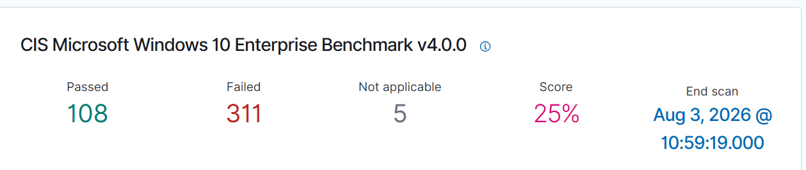<br><em>Figura 20 - Cabeçalho da análise</em></p>

A tabela de checagens traz o identificador, o título, a configuração avaliada e o resultado. Ao abrir uma checagem, são exibidos a **justificativa**, a **remediação**, a **descrição**, o método de **verificação** e os frameworks de **conformidade** relacionados.

<p align="center">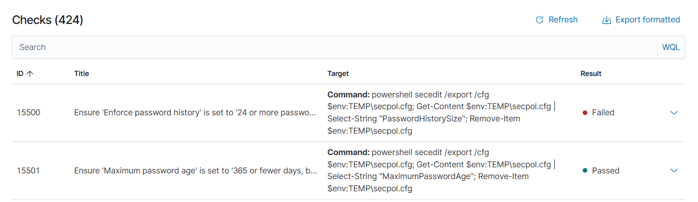<br><em>Figura 21 - Checagens realizadas</em></p>

<p align="center">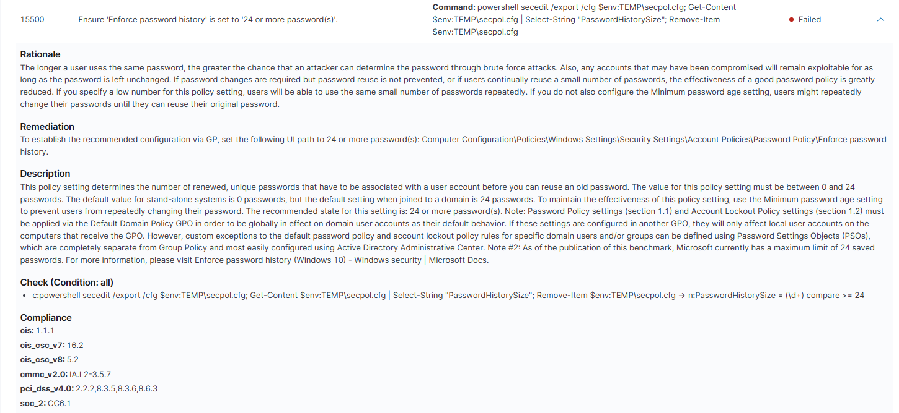<br><em>Figura 22 - Detalhes da checagem</em></p>

A aba **Inventory** mostra o benchmark usado na avaliação, e a aba **Events** registra cada alteração detectada nas configurações monitoradas.

<p align="center">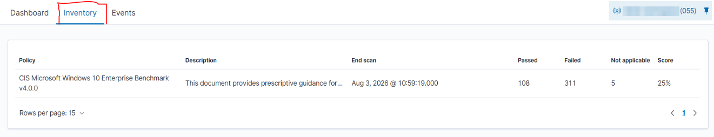<br><em>Figura 23 - Acessando o inventário</em></p>

<p align="center">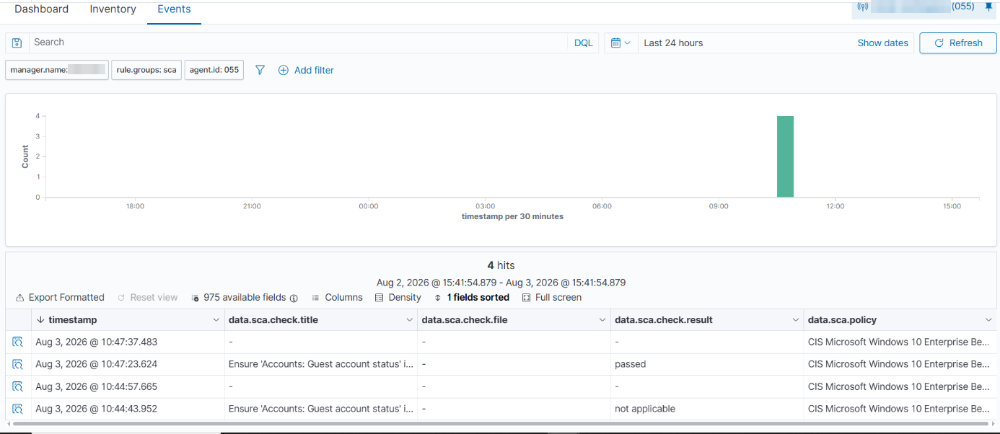<br><em>Figura 24 - Eventos de alteração de configuração</em></p>

### 5.3. Dashboards personalizados

Os dashboards ficam em **Explore > Dashboards**. Cada painel concentra uma tecnologia ou área, com indicadores, gráficos ao longo do tempo, tabelas e a lista de eventos recentes. A lista completa, com o que cada um mostra e como importá-los, está na seção 11.

<p align="center">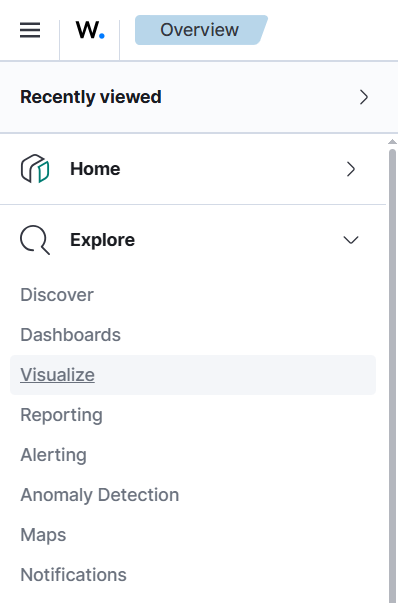<br><em>Figura 25 - Menu lateral com Dashboards, Alerting e Anomaly Detection</em></p>

---

## 6. Administração via CLI

Além da interface gráfica, o Wazuh é administrado pela linha de comando: criação de regras, decoders e listas, ajustes no ossec.conf, consulta de logs e troubleshooting. O acesso deve ser feito por SSH, apenas por usuários autorizados.

```
ssh wazuh-user@192.0.2.10
```

<p align="center">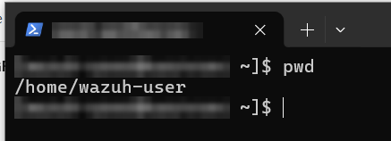<br><em>Figura 26 - Acessando o servidor via SSH</em></p>

Para alterar regras, decoders, listas e configurações, é preciso privilégio administrativo:

```
sudo su
```

<p align="center">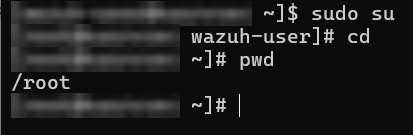<br><em>Figura 27 - Acessando o usuário root</em></p>

> **Atenção:** Use privilégios de **root** somente para as atividades que realmente exigem. Ao terminar, encerre a sessão privilegiada.

### 6.1. Estrutura das regras customizadas

As regras analisam os eventos já decodificados e decidem quais viram alerta e com qual nível. As regras nativas ficam em `/var/ossec/ruleset/rules/` e **não devem ser alteradas**, pois são substituídas nas atualizações. As regras customizadas ficam em:

```
cd /var/ossec/etc/rules
ls -l
```

#### 6.1.1. Ordem de carga: o detalhe mais importante

O Wazuh junta os arquivos de regras de **todas as pastas** (nativas e customizadas) e os carrega em **ordem alfabética pelo nome do arquivo**. As regras nativas usam prefixos de `0010` a `0999`. Uma regra só pode usar como pai (`if_sid`, `if_matched_sid` ou `if_matched_group`) uma regra ou grupo que **já tenha sido carregado**.

Por isso, os arquivos customizados usam o prefixo **9NN** (`901-`, `902-` …), que sempre carrega depois de todo o ruleset nativo, e seguem a ordem das faixas de IDs. O `local_rules.xml` começa com letra e é carregado **por último**, o que permite concentrar nele as regras "pega-tudo".

> **Importante:** Um arquivo chamado `03-erros.xml` é carregado **antes** do nativo `0590-win-system_rules.xml` (o caractere 3 vem antes do 5). As regras filhas da 61102 são descartadas com o aviso **"Empty if_sid value. Rule will be ignored"**. Use sempre o prefixo 9NN.

#### 6.1.2. Arquivos e faixas de IDs

| Arquivo | Faixa de IDs | Conteúdo |
|---|---|---|
| 901-iam-rules.xml | 100200 a 100299 | Gestão de identidades no AD: usuários, contas de máquina, grupos, bloqueios e atributos sensíveis (SPN, UAC, UPN) |
| 902-info-win-rules.xml | 100300 a 100399 | Eventos informativos do Windows e do SQL Server (VSS, MSSQL, DWM) |
| 903-erros-win-rules.xml | 100600 a 100699 | Erros do log System: TLS/Schannel, Netlogon, GPO, serviços e ataque de senha na conta Administrador |
| 904-cisco-asa-rules.xml | 100700 a 100799 | VPN Cisco ASA: conexões, desconexões, erros e falhas de login, com versões fora do horário |
| 905-mssql-rules.xml | 100800 a 100899 | Falhas de login no SQL Server, força bruta e falhas fora do expediente |
| 906-openvpn-rules.xml | 100900 a 100999 | VPN OpenVPN: logon, logoff, timeout, falhas e múltiplas falhas |
| 907-echos-system-rules.xml | 101000 a 101199 | Silenciamento de erros conhecidos, serviços, instalações e logoff de usuários críticos |
| 908-abuse-rules.xml | 101200 a 101299 | IPs externos no Suricata e scans de serviços de varredura (Modat.io) |
| 909-false-positive-rules.xml | 101500 a 101599 | Falsos positivos e saúde do agente (fila de eventos cheia) |
| 910-backup-rules.xml | 101600 a 101699 | Backups com sucesso e falhas |
| 911-temp-rules.xml | 101700 a 101799 | Regras temporárias de teste |
| 912-kaspersky-rules.xml | 101800 a 101899 | Antivírus: ataques de rede, malware, bloqueios, KSN e prevenção de intrusão |
| 913-forcepoint-rules.xml | 101900 a 101999 | DLP: violações e movimentações de dados permitidas e bloqueadas |
| 914-audit-rules.xml | 102000 a 102099 | Auditoria do firewall: configuração, WebGUI, Squid e LDAP |
| 915-squid-rules.xml | 102100 a 102199 | Proxy Squid: acessos e sites restritos (conteúdo adulto e apostas) |
| 916-suricata-rules.xml | 102200 a 102299 | Anomalias de protocolo do Suricata |
| 917-eol-rules.xml | 102300 a 102399 | Softwares e sistemas operacionais em fim de vida (EOL) |
| 918-pfsense-filter-rules.xml | 102400 a 102499 | Filtro do pfSense e IP com múltiplos bloqueios |
| 919-cpu-usage-rules.xml | 102500 a 102599 | Uso de CPU e uso alto sustentado |
| 920-ram-usage-rules.xml | 102600 a 102699 | Uso de memória RAM |
| 921-hdd-rules.xml | 102700 a 102799 | Uso de disco (e-mail diário acima de 90%) |
| 922-hdd-legacy-rules.xml | 102800 a 102899 | Uso de disco em Windows legado |
| 923-manage-wazuh-rules.xml | 102900 a 102999 | Acessos ao servidor Wazuh: SSH, sudo, su, usuários e força bruta |
| 924-monit-power-rules.xml | 103000 a 103099 | Desligamentos manuais e inesperados |
| 925-adm-rules.xml | 103100 a 103199 | Administração do Windows: downloads, FIM, RDP, PsExec, processos suspeitos, logon em cache |
| local_rules.xml | 100000 a 100599 e 101300 a 101499 | Autenticação Windows, RDP, e-mail (OWA), usuários críticos e documentação geral (carregado por último) |

Os nomes podem usar hífen ou sublinhado, mas **precisam terminar em .xml**: arquivos sem a extensão são ignorados sem nenhum aviso. Faixas livres: **103200 em diante**.

#### 6.1.3. Padrão de cabeçalho

Todo arquivo de regras começa com um cabeçalho que documenta a finalidade, as dependências e a faixa de IDs reservada:

```
<!--  ===========================================================================
Categoria: VPN - OpenVPN
Descrição: Regras de autenticação e sessão de usuários na VPN OpenVPN:
logon, logoff, falhas de login, timeout e versões fora do horário comercial.
Dependência: decoder custom-openvpn
Observação: o horário considerado é o do servidor Wazuh (manager)

Faixa de IDs:
100900 - 100999
============================================================================= -->
```

O `local_rules.xml` traz, além das suas regras, um **cabeçalho mestre** que documenta todo o conjunto: tabela de arquivos e faixas, listas CDB, decoders customizados, dependências entre arquivos, pais nativos mais usados e convenções.

> **Importante:** Comentários XML **não podem conter dois hífens seguidos** (`--`). Linhas de separação feitas com traços tornam o arquivo inválido. Use `=` ou `_`.

#### 6.1.4. Convenções adotadas

- **IDs em sequência**, na ordem em que as regras aparecem no arquivo, dentro da faixa reservada.
- **Regras irmãs** (mesmo pai) são avaliadas na ordem em que aparecem e a primeira que casa vence: a mais **específica** deve vir antes da mais genérica.
- **Regras "pega-tudo"** (filhas sem condição) bloqueiam todas as irmãs carregadas depois delas. Ficam no fim do arquivo ou, quando servem de pai para outros arquivos, são documentadas como dependência.
- **Correlações** (`frequency`) contam a regra **final** de cada evento. Quando o evento pode terminar em mais de uma regra (por exemplo, normal e fora do horário), conte por **grupo** (`if_matched_group`).
- Regras de **horário** (`<time>`) devem ser **filhas** da regra normal, nunca irmãs com a mesma condição.
- Eventos que o Wazuh pode classificar em mais de uma regra nativa usam `if_sid` com **lista** (`60137, 67023`), sempre com o `eventID` explícito para limitar o alcance.
- Dashboards e filtros devem usar `rule.groups` sempre que possível, pois os grupos não mudam quando uma regra é renumerada.

#### 6.1.5. Pais nativos mais usados

| Regra nativa | Evento |
|---|---|
| 60106 | Logon com sucesso (4624) |
| 67022 | Logon que não é de rede nem de serviço (4624 tipos 2, 4, 7, 8, 10, 11, 13) |
| 60137 / 67023 | Logoff (4634): 60137 para tipo 3, 67023 para os demais |
| 60122 | Falha de logon (4625) |
| 67027 | Criação de processo (4688) |
| 61100 / 61101 / 61102 / 61103 | Eventos do log System: informativo, aviso, erro e crítico |
| 61138 / 92650 | Serviço criado (7045) / serviço em %SystemRoot% (padrão do PsExec) |
| 67018 | Desligamento iniciado (1074) |
| 5710 / 5715 / 5716 / 5760 | SSH: usuário inexistente, login com sucesso e falhas de senha |

Para descobrir qual regra nativa trata um evento, use o **wazuh-logtest** (seção 6.2) ou procure nas regras nativas:

```
grep -rn -A4 'rule id="611' /var/ossec/ruleset/rules/ | grep -E 'rule id|if_sid|description'
```

### 6.2. Testando regras: wazuh-logtest e validação

Antes de reiniciar o manager, **valide** a configuração. O comando abaixo carrega todas as regras e mostra erros e avisos, sem afetar o serviço:

```
/var/ossec/bin/wazuh-analysisd -t
```

Para testar como um log é decodificado e qual regra dispara, use o **wazuh-logtest** e cole uma linha real do log:

```
/var/ossec/bin/wazuh-logtest
```

A saída tem três fases: **Phase 1** (pré-decodificação), **Phase 2** (decoder e campos extraídos, com os nomes exatos) e **Phase 3** (regra que casou, nível e descrição). Correlações (`frequency`) podem ser testadas colando várias linhas na **mesma sessão**.

> **Nota:** Se a Phase 3 mostrar a descrição antiga de uma regra, o arquivo novo ainda não foi copiado para o servidor ou o manager não foi reiniciado.

### 6.3. Decoders

Os decoders interpretam os logs recebidos e extraem os campos usados pelas regras. Se um evento não for decodificado corretamente, nenhuma regra customizada consegue analisá-lo. Os decoders customizados ficam em `/var/ossec/etc/decoders`; os nativos não devem ser alterados.

```
cd /var/ossec/etc/decoders
ls -l
```

<p align="center">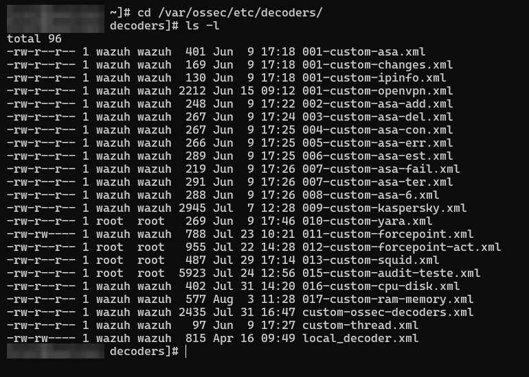<br><em>Figura 28 - Listando os decoders</em></p>

| Decoder | Descrição |
|---|---|
| 001-custom-asa.xml | Base para eventos do Cisco ASA |
| 001-custom-changes.xml | Eventos de alterações monitoradas |
| 001-custom-openvpn.xml | Logs do OpenVPN |
| 002 a 008-custom-asa-*.xml | Eventos do Cisco ASA: inclusão, remoção, conexão, erro, estabelecimento, falha, encerramento e nível 6 |
| 009-custom-kaspersky.xml | Logs do Kaspersky Endpoint Security |
| 010-custom-yara.xml | Eventos do YARA |
| 011 e 012-custom-forcepoint*.xml | Eventos e ações do DLP Forcepoint |
| 013-custom-squid.xml | Logs do proxy Squid |
| 015-custom-audit-teste.xml | Logs de auditoria (teste) |
| 016-custom-cpu-disk.xml | Uso de CPU e disco |
| 017-custom-ram-memory.xml | Uso de memória RAM |
| custom-ossec-decoders.xml | Decoders auxiliares do próprio Wazuh |
| custom-thread.xml | Enriquecimento e inteligência de ameaças |
| local_decoder.xml | Decoders locais |

> **Atenção:** Crie decoders apenas quando não houver suporte nativo adequado, quando o formato do log for diferente do esperado ou quando for preciso extrair campos adicionais. Antes, confira se um decoder nativo já entrega os campos necessários.

> **Nota:** Campos extraídos por decoders customizados chegam ao índice como **texto**. Valores numéricos (como percentuais de uso) não permitem média nem gráficos de linha nos dashboards sem um ajuste no mapeamento do índice.

### 6.4. Listas CDB

As listas CDB guardam valores de referência (IPs, domínios, usuários, hashes, processos) consultados pelas regras durante o processamento. Ficam em `/var/ossec/etc/lists/` e precisam ser registradas no bloco `<ruleset>` do ossec.conf.

<p align="center">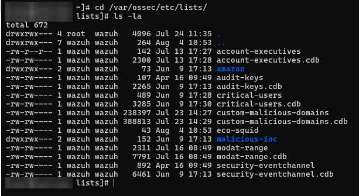<br><em>Figura 29 - Listas CDB</em></p>

Formato: uma entrada por linha, terminando com dois-pontos e, opcionalmente, um valor. Chaves que contêm dois-pontos (como caminhos do Windows ou `site.com:443`) ficam entre aspas:

```
usuario.admin:
"www.exemplo.com:443":
"C:\\Windows\\System32\\cmd.exe":shell
```

| Lista | Uso |
|---|---|
| critical-users | Usuários críticos/administrativos |
| ip-sec-list | IPs da equipe de segurança (exceções e logins permitidos) |
| modat-range | IPs de serviços de varredura conhecidos |
| white-list-sites | Sites liberados no proxy |
| adult-sites / bet-sites | Sites restritos (comparação exata com o campo url) |
| kernel-power | IDs de eventos de energia |
| lolbins_vigiados | Ferramentas nativas do Windows usadas em ataques |

- `match_key` compara **texto exato**: `www.site.com:443` não casa com `site.com:443`. Cadastre cada variação necessária.
- Para IPs e redes (`10.0.0.0/8`), use `address_match_key` e `not_address_match_key`.
- Caminhos do Windows chegam ao Wazuh com **barras invertidas duplicadas**; a lista precisa seguir o mesmo formato.

```
<list>etc/lists/lolbins_vigiados</list>
```

### 6.5. Arquivo ossec.conf

O `/var/ossec/etc/ossec.conf` é o principal arquivo de configuração: coleta de logs, integrações, módulos, comandos, e-mail e o carregamento de regras, decoders e listas.

<p align="center">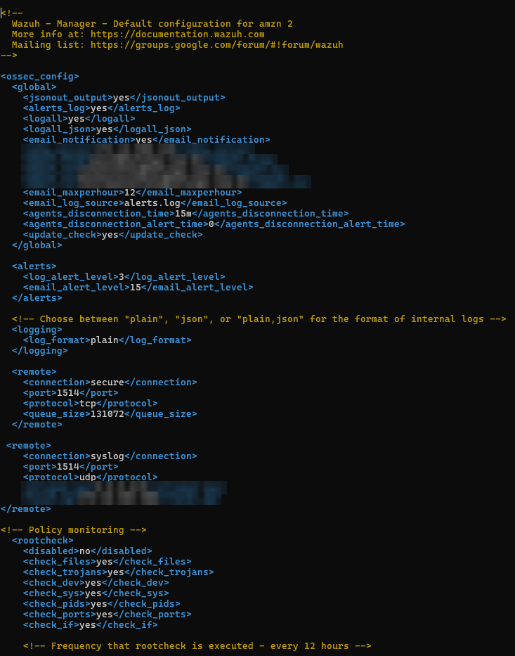<br><em>Figura 30 - Arquivo ossec.conf</em></p>

> **Importante:** Alterações incorretas no ossec.conf podem impedir a inicialização do Wazuh. Faça **backup**, valide a sintaxe, documente a mudança e reinicie somente após validar.

| Bloco | Função |
|---|---|
| <ossec_config> | Elemento raiz. Não remover. |
| <global> | E-mail (`email_notification`, `smtp_server`, `email_from`, `email_to`) e opções gerais. Evite destinatários repetidos. |
| <logall> / <logall_json> | Arquiva todos os eventos recebidos, inclusive os que não viram alerta. Aumenta muito o volume de disco. |
| <alerts> | `log_alert_level` (mínimo para gravar alerta, padrão 3) e `email_alert_level` (mínimo para e-mail, padrão 12). |
| <remote> | Comunicação com agentes (1514) e recebimento de syslog (514). |
| <localfile> | Fontes de log locais (arquivos, journald, Event Channel, comandos). |
| <ruleset> | Diretórios de regras e decoders e registro das listas CDB. |
| <integration> | Integrações externas (Slack, VirusTotal, scripts próprios). |

### 6.6. Coleta de logs do journald

Em sistemas que registram autenticação apenas no journald (sem `/var/log/secure`), adicione ao ossec.conf do servidor:

```
<localfile>
  <location>journald</location>
  <log_format>journald</log_format>
</localfile>
```

Para conferir onde os logs de SSH estão sendo gravados: `journalctl -u sshd --since "1 hour ago"`. Mantenha apenas uma fonte (journald **ou** arquivo) para não duplicar eventos.

## 7. Diretórios e arquivos sensíveis

| Caminho | Conteúdo e cuidados |
|---|---|
| /var/ossec/ruleset/ | Regras e decoders nativos. Não alterar: são substituídos nas atualizações. |
| /var/ossec/etc/rules/ e /decoders/ e /lists/ | Customizações. Versionar e fazer backup. |
| /var/ossec/etc/shared/ | Configurações de grupos de agentes (agent.conf). |
| /var/ossec/api/configuration/security/ | Segurança e controle de acesso da API. |
| /var/ossec/logs/ | Logs internos (ossec.log), alertas (alerts/) e arquivos (archives/). Essencial para troubleshooting. |
| /var/ossec/etc/internal_options.conf | Opções internas. Não alterar: é sobrescrito nas atualizações. |
| /var/ossec/etc/local_internal_options.conf | Opções internas personalizadas. É aqui que se fazem ajustes. |
| /var/ossec/etc/sslmanager.key e .cert | Chave privada e certificado. Acesso restrito; exposição exige renovação. |
| wazuh-install-files.tar | Senhas e certificados gerados na instalação. Guardar em cofre. |

> **Atenção:** Antes de alterar qualquer um desses itens: faça backup, registre a mudança (data, responsável, motivo), restrinja o acesso e valide antes de reiniciar.

---

## 8. Instalação de agentes

Pré-requisitos: sistema operacional compatível, acesso administrativo ao equipamento, conectividade com o servidor nas portas **1514** e **1515**, nome padronizado para o agente e grupo definido. Recomenda-se usar a mesma versão de agente adotada como padrão no ambiente (nunca mais nova que o servidor).

### 8.1. Instalação pelo Dashboard (recomendada)

Em **Endpoints**, clique em **Deploy new agent**. O assistente gera o comando de instalação já com o endereço do servidor, o nome e o grupo do agente.

<p align="center">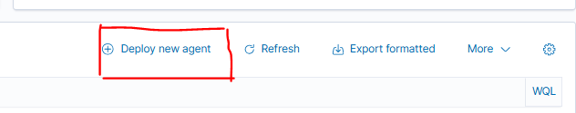<br><em>Figura 31 - Criando novo agente</em></p>

1. **Sistema operacional** do equipamento.
2. **Endereço do servidor** (IP ou FQDN).
3. **Nome do agente** (preferencialmente o hostname).
4. **Grupo** do agente.
5. **Comando de instalação** gerado.
6. **Início do serviço** do agente.

<p align="center">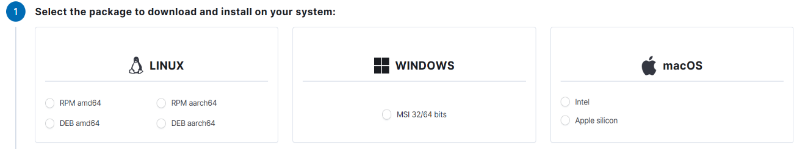<br><em>Figura 32 - Selecionando o sistema operacional</em></p>

<p align="center">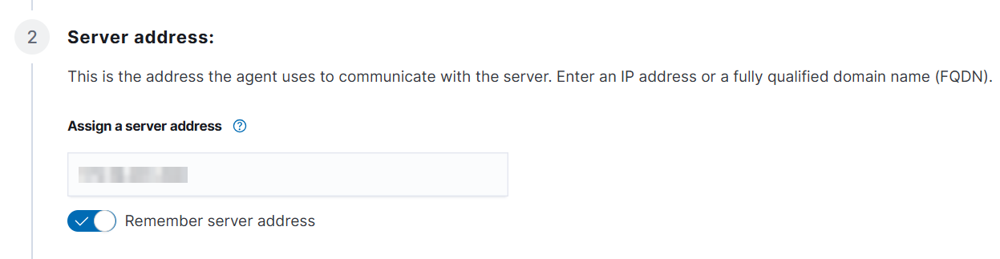<br><em>Figura 33 - Endereço do servidor</em></p>

<p align="center">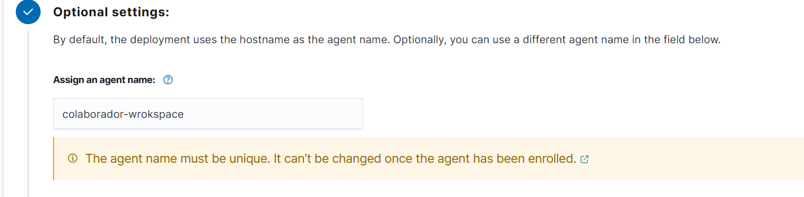<br><em>Figura 34 - Nome do agente</em></p>

> **Nota:** O nome do agente deve ser **único** e não pode ser alterado depois do cadastro.

<p align="center">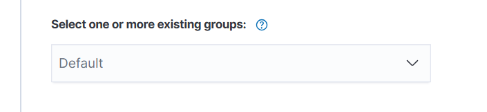<br><em>Figura 35 - Selecionando os grupos</em></p>

Execute o comando gerado no **PowerShell como Administrador** (Windows) ou como root (Linux) e depois inicie o serviço:

<p align="center">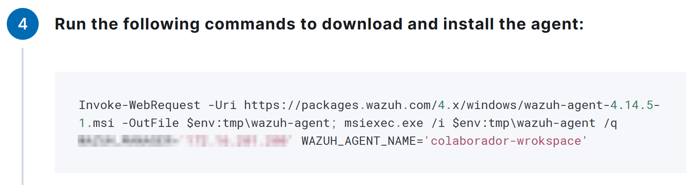<br><em>Figura 36 - Comando de instalação</em></p>

```
NET START Wazuh
```

<p align="center">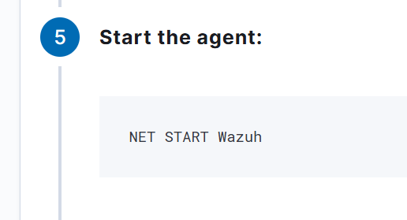<br><em>Figura 37 - Iniciando o agente</em></p>

### 8.2. Instalação pelo instalador do site

Também é possível baixar o instalador pela documentação oficial: https://documentation.wazuh.com/current/installation-guide/wazuh-agent/index.html

<p align="center">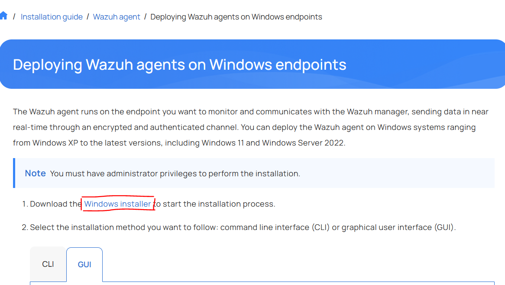<br><em>Figura 38 - Página oficial de instalação do agente</em></p>

Confira a versão do instalador: nem todas as versões intermediárias ficam disponíveis para download, e o agente não deve ser mais novo que o servidor. Alguns navegadores bloqueiam o download; confirme a origem antes de liberar.

<p align="center">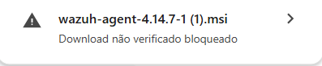<br><em>Figura 39 - Instalador .msi</em></p>

|  | Pelo Dashboard | Pelo instalador do site |
|---|---|---|
| Já se conecta ao servidor | Sim | Não |
| Define o grupo | Sim | Não |
| Nome do agente | Personalizável | Hostname da máquina |
| Chave de autenticação | Automática | Manual |
| Configuração adicional | Não | Sim |

<p align="center">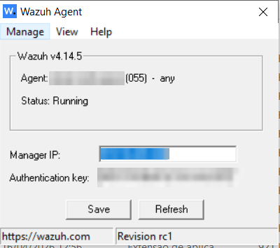<br><em>Figura 40 - Agente configurado pelo Dashboard</em></p>

<p align="center">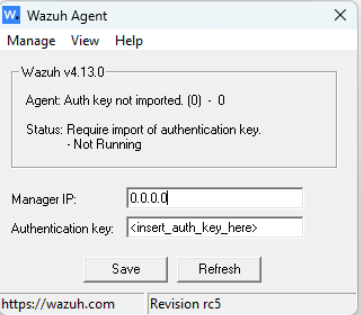<br><em>Figura 41 - Agente instalado pelo .msi, sem configuração</em></p>

### 8.3. Cadastro manual do agente no servidor

Quando o agente é instalado pelo .msi, cadastre-o no servidor e copie a chave para o agente:

```
/var/ossec/bin/manage_agents
```

Use **A** (Add agent) para cadastrar nome e IP e **E** (Extract key) para obter a chave do ID criado. Informe a chave e o IP do servidor na tela do agente e reinicie o serviço.

<p align="center">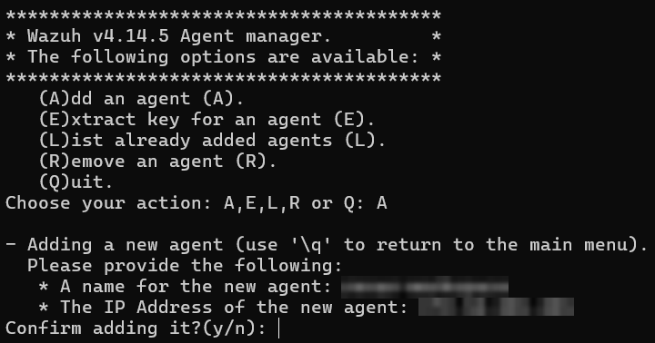<br><em>Figura 42 - Cadastrando o agente</em></p>

<p align="center">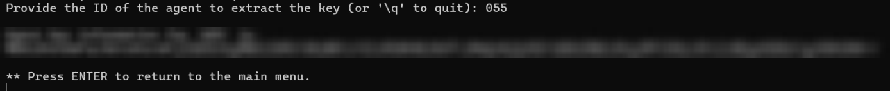<br><em>Figura 43 - Extraindo a chave do agente</em></p>

> **Importante:** A chave de autenticação é uma **credencial**. Não a compartilhe, não a registre em documentos e não a envie por e-mail ou chat.

---

## 9. Comandos remotos e configuração por grupo

O `agent.conf` de cada grupo permite distribuir configurações aos agentes, inclusive comandos que rodam periodicamente (por exemplo, para garantir que a política de auditoria do Windows esteja ativa).

> **Importante:** Comandos remotos rodam como **SYSTEM** (Windows) ou **root** (Linux) em todos os agentes do grupo. Aplique somente a grupos que realmente precisam, com comandos testados e documentados.

### 9.1. Habilitando no agente

No `local_internal_options.conf` do agente (Windows: `C:\Program Files (x86)\ossec-agent\`), adicione e reinicie o serviço:

```
logcollector.remote_commands=1
```

Para o módulo `wodle command`, a opção é `wazuh_command.remote_commands=1`. Prefira sempre o `local_internal_options.conf`: o `internal_options.conf` é sobrescrito nas atualizações. Em muitos agentes, a alteração pode ser feita com um script (.bat) que se auto-eleva, altera o arquivo e reinicia o serviço; para execução sem interação, distribua-o por GPO ou tarefa agendada como SYSTEM.

### 9.2. Configurando no servidor

Pela interface, em **Agents management > Groups**, clique no lápis do grupo para editar o `agent.conf`. Pela CLI, o arquivo fica em `/var/ossec/etc/shared/<grupo>/agent.conf`.

<p align="center">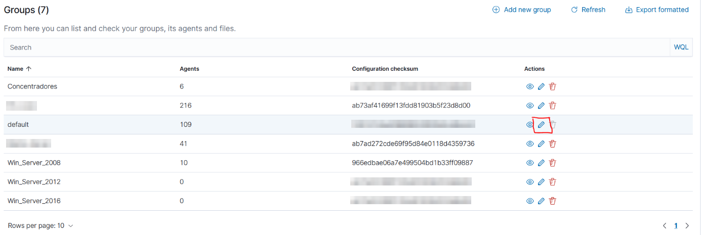<br><em>Figura 44 - Editando a configuração do grupo</em></p>

<p align="center">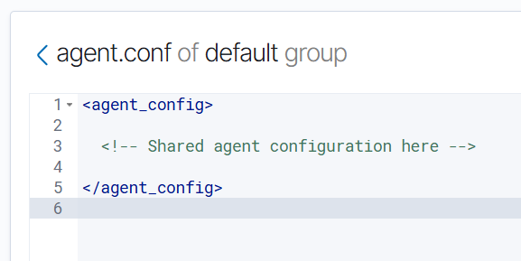<br><em>Figura 45 - agent.conf padrão</em></p>

<p align="center">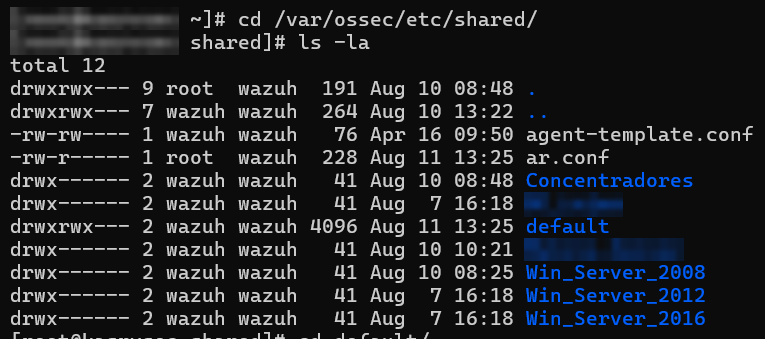<br><em>Figura 46 - Configurações compartilhadas por grupo</em></p>

<p align="center">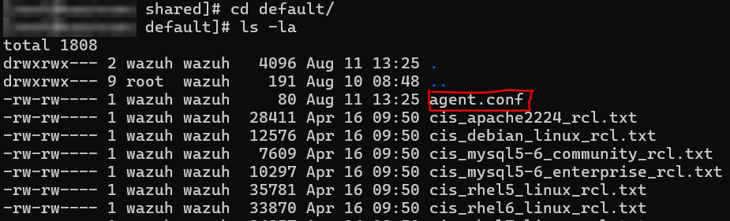<br><em>Figura 47 - Localizando o agent.conf do grupo</em></p>

<p align="center">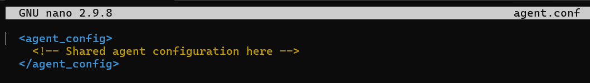<br><em>Figura 48 - Editando o agent.conf pela CLI</em></p>

Exemplo: garantir a auditoria de logon e de criação de processos nos servidores Windows do grupo (GUIDs funcionam em Windows em português e em inglês):

```
<agent_config>
  <localfile>
    <log_format>full_command</log_format>
    <command>auditpol /set /subcategory:{0CCE9215-69AE-11D9-BED3-505054503030} /success:enable /failure:enable</command>
    <alias>auditpol_logon</alias>
    <frequency>3600</frequency>
  </localfile>
  <localfile>
    <log_format>full_command</log_format>
    <command>auditpol /set /subcategory:{0CCE922B-69AE-11D9-BED3-505054503030} /success:enable</command>
    <alias>auditpol_process_creation</alias>
    <frequency>3600</frequency>
  </localfile>
</agent_config>
```

Valide e acompanhe a sincronização:

```
/var/ossec/bin/verify-agent-conf -f /var/ossec/etc/shared/<grupo>/agent.conf
/var/ossec/bin/agent_groups -S -i <ID_DO_AGENTE>
```

> **Atenção:** O `frequency` padrão é 360 segundos, e cada execução gera um evento. Use intervalos compatíveis com a necessidade (uma hora ou um dia) para não gerar volume desnecessário nem encher a fila do agente. Em domínio, prefira GPO para a política de auditoria.

Os agentes recebem o novo `agent.conf` automaticamente e reiniciam sozinhos. Evite `agent_control -R -a`, que reinicia **todos** os agentes.

## 10. Gerenciamento de grupos de agentes

Os grupos organizam os agentes por finalidade, tipo ou localização e permitem aplicar configurações específicas. Um agente pode pertencer a **mais de um grupo**; nesse caso, as configurações são combinadas, então avalie sobreposições antes de alterar um `agent.conf`.

### 10.1. Criando um grupo

Em **Agents management > Groups**, clique em **Add new group**, informe um nome simples e padronizado e salve.

<p align="center">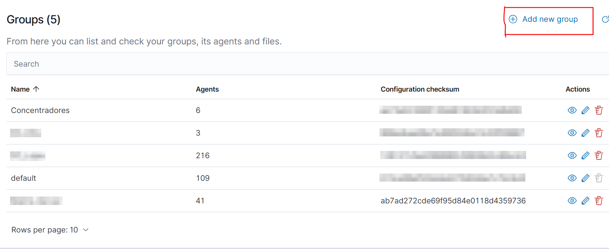<br><em>Figura 49 - Criando novo grupo</em></p>

<p align="center">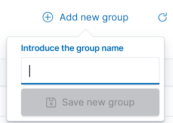<br><em>Figura 50 - Nome do grupo</em></p>

### 10.2. Adicionando agentes

Abra o grupo e clique em **Manage agents**. Mova os agentes entre **Available agents** e **Current agents in the group** (botões ou duplo clique) e confirme em **Apply changes**.

<p align="center">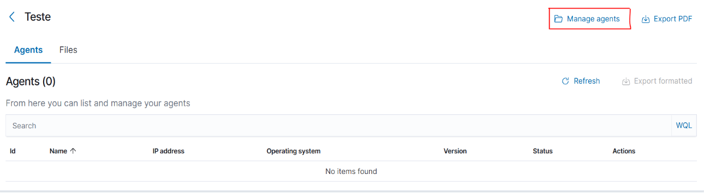<br><em>Figura 51 - Gerenciando os agentes do grupo</em></p>

<p align="center"><br><em>Figura 52 - Alocando agentes ao grupo</em></p>

<p align="center"><br><em>Figura 53 - Confirmando o agente no grupo</em></p>

---

## 11. Dashboards personalizados

Os dashboards são distribuídos como arquivos **NDJSON** e importados em **Dashboards Management > Saved Objects > Import** (marque a opção de sobrescrever). Se aparecer aviso de index pattern não encontrado, escolha o `wazuh-alerts-*`. O padrão de nomes é **[CATEGORIA] Assunto**.

| Dashboard | Conteúdo |
|---|---|
| [AD] Gestão de Identidades | Usuários, grupos, contas de máquina, bloqueios e atributos sensíveis do AD |
| [ANTIVIRUS] Kaspersky | Ataques de rede, malware, downloads e sites bloqueados, KSN e prevenção de intrusão |
| [BANCO] SQL Server | Logins e falhas de login, força bruta e acessos fora do expediente |
| [DLP] Forcepoint | Violações e movimentações de dados permitidas e bloqueadas |
| [FIREWALL] Auditoria | Alterações de configuração, WebGUI e autenticação do Squid |
| [FIREWALL] Tráfego e Bloqueios | IPs com múltiplos bloqueios, portas e destinos visados |
| [GERAL] Visão Geral | Alertas de nível 10 ou mais de todas as áreas (porta de entrada) |
| [IDS] Suricata e Threat Intelligence | IPs externos, assinaturas, anomalias de protocolo e scans |
| [INFRA] Desempenho | CPU, RAM e disco acima dos limites |
| [INFRA] Saúde e Manutenção | Backups, EOL, desligamentos e agentes desconectados |
| [PROXY] Squid CD / [PROXY] Squid Matriz | Navegação, usuários, destinos e sites restritos |
| [VPN] Cisco ASA / [VPN] OpenVPN | Conexões, falhas e eventos fora do horário |
| [WAZUH] Acessos ao Manager | SSH, sudo, sessões de root e força bruta no servidor |
| [WINDOWS] Autenticação e RDP | Logins RDP, falhas, força bruta, usuários críticos e e-mail |
| [WINDOWS] Monitoramento Diário | Serviços, instalações, erros relevantes e política de auditoria |
| [WINDOWS] Movimento Lateral e Processos | PsExec, LOLBins, processos disfarçados, downloads e logon em cache |

Todos seguem o mesmo layout: indicadores por categoria no topo, gráfico ao longo do tempo, três tabelas e a lista de eventos recentes. Os filtros usam `rule.groups` sempre que possível, para continuar funcionando se as regras forem renumeradas.

> **Nota:** Se uma tabela aparecer vazia enquanto o resumo mostra eventos, o nome do campo é diferente no seu índice. Confira o campo no Discover e ajuste a visualização.

## 12. Alerting e notificações

O **Alerting** executa consultas agendadas sobre os alertas e notifica quando uma condição é atendida. Ele complementa as regras justamente onde elas não alcançam: **ausência** de eventos (o backup não rodou, um log parou de chegar) e **resumos** (um aviso consolidado em vez de dezenas de e-mails).

> **Atenção:** Os comandos desta seção vão para o **indexer**. No Dashboard, o console certo é `/app/dev_tools#/console`; o menu Server management > Dev Tools fala com a API do Wazuh e devolve "404 - Not Found". Pelo terminal, use `curl -k -u admin https://localhost:9200/...`.

### 12.1. Canal de e-mail

Crie o remetente (servidor SMTP) e o canal (destinatários), reaproveitando o servidor de e-mail já usado no ossec.conf:

```
{
  "config_id": "smtp-wazuh",
  "config": {
    "name": "SMTP Wazuh", "config_type": "smtp_account", "is_enabled": true,
    "smtp_account": { "host": "192.0.2.25", "port": 25, "method": "none",
                      "from_address": "wazuh-reports@exemplo.com.br" }
  }
}
```

```
{
  "config_id": "email-soc",
  "config": {
    "name": "E-mail SOC", "config_type": "email", "is_enabled": true,
    "email": { "email_account_id": "smtp-wazuh",
               "recipient_list": [ { "recipient": "soc@exemplo.com.br" } ],
               "email_group_id_list": [] }
  }
}
```

```
curl -k -u admin -X POST "https://localhost:9200/_plugins/_notifications/configs" \
  -H "Content-Type: application/json" -d @smtp-sender.json
```

Teste em **Notifications > Channels > Send test message**. Se não chegar, verifique se o servidor SMTP aceita envio a partir do IP do **indexer**.

### 12.2. Monitor de backup não executado

Todo dia às 9h, procura um backup com sucesso nas últimas 26 horas e avisa se não encontrar. Cobre backup que não rodou, que falhou e log que parou de chegar:

```
"schedule": { "cron": { "expression": "0 9 * * *", "timezone": "America/Sao_Paulo" } },
"query": { "bool": { "filter": [
  { "range": { "timestamp": { "gte": "now-26h" } } },
  { "term": { "rule.groups": "backup" } },
  { "term": { "data.backup_status": "sucesso" } } ] } },
"condition": "ctx.results[0].hits.total.value == 0"
```

Teste sem esperar o horário: `POST _plugins/_alerting/monitors/<ID>/_execute?dryrun=true`.

### 12.3. Outros monitores recomendados

| Monitor | Dispara quando |
|---|---|
| Coleta parada | Nenhum alerta de nenhum agente em 15 minutos |
| Log de uma fonte parado | Nenhum evento da fonte (proxy, firewall) em 30 minutos no horário comercial |
| Resumo de sites restritos | Houve acesso a site restrito no dia anterior (um e-mail por dia) |
| Pico de alertas críticos | Mais de N alertas de nível 12 ou mais em 15 minutos |

### 12.4. Notificação no celular

Para avisos imediatos de regras específicas, a forma nativa é a **integração customizada** do Wazuh (`<integration>` com nome `custom-…`, filtrada por `rule_id`, `level` ou `group`), que chama um script no momento do alerta. O script pode enviar a mensagem por um provedor de SMS, por um gateway próprio (celular Android ou modem com Gammu) ou por mensageiros como Telegram ou ntfy. Limite o envio a poucas regras críticas e trate rajadas no script.

## 13. Detecção de anomalias

O plugin **Anomaly Detection** aprende o comportamento normal de uma métrica (por exemplo, falhas de login por servidor a cada 10 minutos) e aponta desvios, mesmo quando nenhuma regra é violada. Funciona bem com eventos **frequentes**; eventos raros (acesso a site restrito, PsExec) ficam melhor nas regras.

| Detector | Filtro | Separado por |
|---|---|---|
| Falhas de autenticação | rule.groups: authentication_failed | agent.name |
| Navegação no proxy | regra de acesso do proxy | IP de origem |
| Volume de alertas | todos os alertas | agent.name |
| Logins bem-sucedidos | rule.groups: authentication_success | usuário |
| Movimentações no DLP | grupo do DLP | usuário |

Crie pelo menu ou pelo console do indexer (`POST _plugins/_anomaly_detection/detectors`), com campo de tempo `timestamp`, intervalo de 10 minutos e atraso de 2 minutos. Execute também a análise histórica para acelerar o aprendizado e crie um monitor no Alerting para notificar notas de anomalia altas.

---

## 14. Problemas comuns e soluções

Lista dos problemas mais frequentes encontrados na construção e manutenção das regras, dashboards e integrações, com a causa e a correção.

#### 14.1. Arquivo de regras é ignorado sem nenhum aviso

**Causa:** O nome não termina em **.xml** (por exemplo, `19-cpu_rules`). O Wazuh só carrega arquivos com a extensão.

**Solução:** Renomeie para `.xml` e rode `wazuh-analysisd -t`.

#### 14.2. "Signature ID X was not found" / "Empty if_sid value. Rule will be ignored"

**Causa:** O arquivo com a regra pai é carregado **depois** do arquivo da regra filha. Os arquivos de todas as pastas são ordenados juntos pelo nome; `03-…` carrega antes do nativo `0590-…`.

**Solução:** Use o prefixo **9NN** nos arquivos customizados e mantenha o pai em arquivo de número menor.

#### 14.3. "Group X was not found. Invalid if_group"

**Causa:** A regra usa `if_matched_group` de um grupo definido em regra carregada depois.

**Solução:** Coloque a correlação depois da regra que define o grupo (no mesmo arquivo ou em arquivo posterior).

#### 14.4. Regra nunca dispara, sem erro

**Causa:** Nome de campo com maiúscula errada (`TargetUserName` em vez de `targetUserName`) ou campo inexistente. Nomes de campo diferenciam maiúsculas e minúsculas.

**Solução:** Confira o nome exato no detalhe do alerta (Discover) ou na Phase 2 do wazuh-logtest.

#### 14.5. Regra nunca dispara, mesmo com o campo certo

**Causa:** Uma regra irmã anterior, com condição igual ou mais ampla (ou uma regra pega-tudo), captura o evento primeiro.

**Solução:** Coloque a regra mais específica antes. Use o wazuh-logtest para ver qual regra ganhou.

#### 14.6. Regra de "fora do horário" nunca dispara

**Causa:** Ela é irmã da regra normal com a mesma condição; a normal vem antes e ganha sempre.

**Solução:** Torne a regra de horário **filha** da regra normal.

#### 14.7. Correlação (frequency) não dispara

**Causa:** Ela conta a regra **final** dos eventos; se os eventos terminam numa filha, a contagem não avança. Ou o nível está abaixo de 3.

**Solução:** Conte por **grupo** (`if_matched_group`) e use nível 3 ou mais.

#### 14.8. Regra classifica eventos errados

**Causa:** Regex sem âncora: `^(1|1000)` casa com qualquer ID começando com 1; `5` casa com 1500, 7045 etc.

**Solução:** Ancore os valores: `^(1|1000)$`, `^5$`.

#### 14.9. Regex de caminho do Windows não casa

**Causa:** Os caminhos chegam com **barras duplicadas** (`C:\\Windows\\…`). Em PCRE2, `\S`, `\C` e `\V` são comandos, não barras.

**Solução:** Use `\\+` para representar uma ou mais barras.

#### 14.10. Lista CDB "could not be loaded"

**Causa:** Caminho errado no ossec.conf (`etc/list/` em vez de `etc/lists/`), arquivo com `.txt` no nome ou sem permissão de leitura.

**Solução:** Corrija o `<list>`, remova a extensão, ajuste dono e permissão (wazuh:wazuh, 660).

#### 14.11. Lista CDB carrega, mas nunca casa

**Causa:** `match_key` exige igualdade exata; o campo vem com porta, caminho ou formato diferente da lista. Para IPs com faixas, `match_key` não funciona.

**Solução:** Ajuste a lista ao formato real do campo; para IPs use `address_match_key`.

#### 14.12. Logs de SSH, sudo e PAM do servidor não chegam

**Causa:** O sistema grava só no journald, sem `/var/log/secure`.

**Solução:** Adicione o `<localfile>` do journald (seção 6.6).

#### 14.13. Dev Tools retorna "404 - Not Found"

**Causa:** O comando foi enviado ao console da **API do Wazuh** (Server management > Dev Tools), e não ao indexer.

**Solução:** Use o console do indexer (`/app/dev_tools#/console`) ou `curl -k -u admin https://localhost:9200/...`.

#### 14.14. Comandos do agent.conf não são executados

**Causa:** Os agentes recusam comandos remotos por padrão.

**Solução:** Habilite `logcollector.remote_commands=1` (ou `wazuh_command.remote_commands=1` para o wodle) no `local_internal_options.conf` do agente.

#### 14.15. Dashboard mostra dados estranhos depois de renumerar regras

**Causa:** Alertas antigos continuam no índice com o ID antigo, que agora tem outro significado.

**Solução:** Use períodos posteriores à mudança e prefira filtros por `rule.groups`.

#### 14.16. Alerta não aparece no dashboard

**Causa:** Nível abaixo de 3 (`log_alert_level`).

**Solução:** Suba o nível para 3 se quiser visibilidade.

#### 14.17. Excesso de e-mails

**Causa:** Todo alerta de nível 12 ou mais gera e-mail; métricas coletadas a cada poucos minutos multiplicam o envio.

**Solução:** Use níveis 10 e 11 para destaque sem e-mail; para estados persistentes, envie resumos (regra com `<time>` curta ou monitor do Alerting).

#### 14.18. Alerta "silencia" outros agentes

**Causa:** O atributo `ignore` vale para a regra inteira, não por agente.

**Solução:** Use `ignore` curto ou combine com `same_location`.

#### 14.19. Senha do indexer (porta 9200) desconhecida

**Causa:** Ela é a do usuário admin do dashboard (instalação padrão) ou está no `wazuh-install-files.tar`.

**Solução:** Se perdida, redefina com a ferramenta oficial de senhas, que atualiza todos os componentes.

#### 14.20. Falha de RDP aparece como logon tipo 3

**Causa:** Com **NLA**, a senha é validada antes da sessão, por autenticação de rede; o tipo 10 só aparece com NLA desativado.

**Solução:** Trate a falha tipo 3 como autenticação de rede (RDP, SMB e outros). Para RDP exclusivo, colete o evento 140 do canal RdpCoreTS.

---

## 15. Créditos e referências

O **Wazuh** é desenvolvido e mantido pela **Wazuh Inc.** e por sua comunidade de código aberto. Agradecemos à equipe do Wazuh pela plataforma, pelas regras e decoders nativos e pela documentação oficial, que serviram de base para todo este trabalho.

> **Nota:** Este manual **não é material oficial do Wazuh** e não é endossado pela Wazuh Inc. Os procedimentos refletem a experiência de um ambiente específico e devem ser validados na documentação oficial da sua versão.

- Documentação oficial: https://documentation.wazuh.com
- Guia de instalação: https://documentation.wazuh.com/current/installation-guide/
- Sintaxe de regras: https://documentation.wazuh.com/current/user-manual/ruleset/ruleset-xml-syntax/rules.html
- Comunidade: https://wazuh.com/community/
- MITRE ATT&CK: https://attack.mitre.org
- OpenSearch Alerting e Anomaly Detection: https://opensearch.org/docs/latest/
